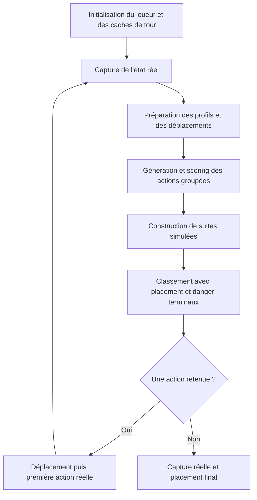

# IA LeekWars

IA orientée simulation : elle améliore des suites d'actions par **online evolution**,
joue la première action, puis replanifie depuis l'état réel du combat.

L'online evolution est le moteur de `main` depuis le **2 novembre 2026**, à la demande
de l'utilisateur. Le main beam précédent est conservé intégralement sur
[`variable-beam-search`](https://github.com/Traual/Leekwars-AI/tree/variable-beam-search)
au commit `3cb1123`. Aucun changement du scoring, des effets, des builds ou des budgets
de production n'accompagne cette migration.

Le dernier candidat avant nettoyage (`f4497ff`) inclut le garde d'enregistrement
des racines. Les 200 combats du candidat antérieur `643c69b` donnent 80 victoires,
50 nuls et 70 défaites contre le beam, soit 52,5 % des points (intervalle apparié à 95 % :
49,25–55,75 %). Le contrôle de 100 combats contre le beam avec identités corrigées
donne 55 % (50–60 %). La promotion exprime un choix de base de code, sans revendiquer
une supériorité statistique démontrée. Les mesures détaillées restent dans
[l'historique](docs/history.md).

## Validation du nettoyage du 2 novembre

Le nettoyage retire 756 lignes de fichiers Leek et conserve les formules, les effets,
les cartes de danger/soin et les réserves de production. Sur 32 recherches sans coupure,
les suites, scores finaux et 10 573 simulations sont identiques au candidat `f4497ff` ;
le coût du banc passe de 230 773 620 à 230 078 719 opérations (−0,30 %).
Aux budgets réels, les 32 suites restent identiques : les 25 plans finançables gardent
leur score, et les sept autres états restent sans plan validé dans les deux versions.

Les 50 contrats généraux, 22 contrats natifs d'invocation/reprise et 25 recalculs complets
de score passent. Quatre combats complets de contrôle, dont le scénario du dépassement
d'opérations corrigé, terminent sans erreur ni interruption. Ce contrôle de migration
ne constitue pas une nouvelle mesure de taux de victoire.

## Utilisation

Importer `ai/` en conservant son arborescence et les chemins des `include`.
Le point d'entrée est [`ai/main`](ai/main). `search/evolution`
porte la recherche ; `search/actions` contient ses outils de jouabilité,
simulation et clôture. Le moteur beam et son sélecteur ne sont plus embarqués.
Les outils de développement et les builds restent dans le dépôt séparé indiqué plus bas.
Les outils d'import et de validation doivent lire les sources de `ai/` sans filtre
d'extension et utiliser `ai/main` comme point d'entrée.

## Recherche par online evolution

La recherche compare des **suites complètes**, arrêt anticipé du tour compris. Elle conserve
le scoring, la simulation des conséquences, les cartes de danger/soin, le placement et les
réserves de production de `main` (`3cb1123`). Aucun bonus particulier à Solidification.

Son fitness est `scoreÉtatFinal − scoreÉtatInitial − pénalitéPlacementFinal` : le dernier
terme est signé et peut donc ajouter un gain. La sélection ne repose pas sur le score brut
des préfixes. Les gains estimés servent seulement à proposer des actions.

1. Construire un plan « arrêter le tour » évalué avec danger, puis revalider les intentions
   restantes du meilleur plan précédent depuis la capture réelle, avant la géométrie froide.
   Scorer les actions locales et valider le meilleur cast local avant l’extension offensive.
   Compléter ensuite avec des plans courts et jusqu’à sept nouveaux départs.
2. Conserver une population de huit plans, classés par fitness final exact. Un tournoi
   entre deux plans choisit le parent. La meilleure suite validée est toujours conservée.
3. Proposer un déplacement d’action dans la suite, une suppression, un remplacement,
   une insertion, une nouvelle fin de suite ou un croisement entre deux plans.
4. Simuler les nouvelles actions dans l’ordre, avec les coûts PT/PM, les cooldowns,
   les usages, les changements d’arme et les effets de déplacement réels. Une suite
   injouable est rejetée entière : `VALID = false`, `VALUE = 0`. Ce zéro ne participe
   jamais au classement, car un plan valide peut avoir un fitness négatif.
5. Évaluer le placement de l’état obtenu avec `ActionSuite.closeOf`. Un résultat tronqué
   ou non finançable ne devient pas un fitness exact ; le meilleur plan validé reste acquis.
6. Exécuter seulement la première action et replanifier depuis la capture réelle.
   La vidange du plan reste celle de `Play` si le budget ne permet plus de recherche.

Les gènes représentent un item et sa **signature de cibles/distances de zone**. Ils ne
figent pas une cellule de lancer pour les effets ordinaires : après une inversion,
un auto-buff suit la nouvelle position du lanceur et un tir retrouve l’entité déplacée.
Les effets sensibles à la géométrie, dont inversion, poussées, invocations et résurrection,
gardent aussi leur origine pertinente et leur visée ou identité visée. La résurrection
conserve explicitement l’identité du mort. Les groupes et origines sont relus dans l’état
produit par chaque préfixe ; un changement de zone/cibles peut invalider l’intention.

Un cache de préfixes immuables évite de répéter leur simulation entre plans ; un autre mémo
reprend directement le fitness d’une suite déjà évaluée. Ces caches vivent **une décision**,
jamais au-delà d’une action réelle. Seules les **intentions** de la meilleure suite peuvent
passer au cast suivant : `Play` doit confirmer le succès de la même action concrète
(item, origine, visée et mort à ressusciter). L’acteur et le tour doivent correspondre.
Un échec, une autre action, un nouveau tour ou un autre poireau annulent la transmission.
Les identités virtuelles sont réservées au-delà des naissances réelles possibles du tour :
`SUMMON_ID_BASE = maxRealId + count(MY_INVENTORY_SUMMON)`, puis un offset par type.
Cette réservation empêche une invocation projetée d’écraser le bulbe qui vient réellement
apparaître. Les calculs des effets et les formules de valeur restent inchangés.

Après un cast d’invocation confirmé, les seules métadonnées transmises sont des identités,
les distances utiles dans les signatures et les gènes. La capture suivante identifie l’unique
nouvel enfant du lanceur et traduit sa signature, sa visée spatiale et son éventuelle cible de
résurrection. Les gènes parents sont conservés. Une naissance absente ou ambiguë annule cette
reprise. Cette traduction appartient à la replanification ; la vidange garde son comportement
historique et ses limites lorsque le budget ne permet plus de chercher.

Chaque intention est resimulée et le danger rescorré dans la capture réelle ; aucun
état ou fitness ancien n’est repris. Une suite revalidée ne retire plus de départ frais :
avec une population de huit, jusqu’à sept nouveaux départs restent essayés, puis la sélection
conserve les huit meilleurs plans. Les queues vides ne sont pas stockées.

Le générateur pseudo-aléatoire est privé à la recherche : il ne consomme pas les jets
du moteur de combat. Il utilise les bits supérieurs de son LCG : les bits faibles
avaient une corrélation entre le choix d’option et le tirage d’exploration qui pouvait
supprimer l’exploration dans certains motifs de tirages successifs.

Deux réglages de départ, encore expérimentaux : `EVOLUTION_POPULATION = 8` et
`EVOLUTION_MAX_ATTEMPTS = 128`. Ce dernier borne les tentatives de mutation, y compris
doublons et rejets ; le plafond d’opérations commun peut arrêter la recherche avant.
`EVOLUTION_REUSE_PLAN_COUNT = 1` reprend seulement le meilleur plan ; `0` désactive cette
reprise pour le témoin. Les valeurs supérieures à 1 permettent d’expérimenter plusieurs
queues compatibles ; elles n’ont pas fait mieux que la meilleure seule dans les sondes.
Les PT/usages/cooldowns bornent la longueur des suites, sans horizon fixe en actions.
Le debug `[OEP]` donne les tentatives, plans évalués, rejets, doublons, évaluations non
finançables, simulations, réutilisations de préfixes et suites reprises/validées.

L’approche s’inspire de la recherche de suites avec vérification des actions de
[Justesen et al.](https://njustesen.github.io/njustesen/publications/justesen2017playing.pdf).
La replanification après le premier cast est notre adaptation aux jets réels du jeu.
L’étude de [Gaina et al.](https://arxiv.org/abs/1704.07075) motive la nécessité de mesurer
les paramètres ; elle ne garantit pas que cette variante soit supérieure à notre beam.


## Déroulement d'un tour



1. `main` charge le catalogue et la géométrie au premier tour, puis appelle
   `ReloadCacheNewTurn` **avant** `Preload.InitStateClass`. Cette dernière fixe `Me`,
   l'inventaire, les catégories d'actions et le coût minimal d'un item disponible.
2. `Play` capture le combat avec `StateClass.Virtualize`. Les caractéristiques,
   cellules, effets et ressources réels deviennent les entrées de la décision.
   Le debug des coefficients s'affiche une fois au début du tour s'il est activé.
3. Le plafond de recherche réserve des opérations au placement et aux bulbes du
   propriétaire qui doivent encore jouer. Le plafond moteur vaut `getCores() × 1 000 000`.
4. `OnlineEvolution` prépare le contexte de scoring, le soutien allié, le potentiel
   offensif de placement et les quatre couches de déplacement de Me. Il calcule
   le score initial, génère les actions, puis développe des suites.
5. Les candidats terminaux sont comparés après soustraction de leur meilleure
   pénalité de placement. Un plan déjà complètement évalué avec danger est conservé.
6. `Play` exécute seulement la **première** action : rejoindre `From`, équiper
   éventuellement l'arme, puis lancer vers `To`. Invocation et résurrection ont
   leurs appels moteur propres ; l'ID à ressusciter est celui choisi en simulation.
7. Une action jouée entraîne une nouvelle capture et une nouvelle recherche.
   Une première erreur d'exécution replanifie ; une deuxième erreur identique,
   à cellule/ressources/arme identiques, arrête les actions et passe au placement.
8. Si le budget ne finance plus de recherche, `drainChain` tente la suite du dernier
   plan dans la marge autorisée, sans construire un nouvel arbre. Chaque déplacement
   et lancer peut échouer ; la vidange s'arrête alors. Elle n'est pas une revalidation
   complète de la suite contre les conséquences réelles des casts précédents.
9. À la sortie, `Play` capture une dernière fois le combat, appelle `FinalCell.get`
   et tente le déplacement final. Un échec est journalisé, sans nouvelle boucle.

Les **bulbes** invoqués avec `Bulb.AI` utilisent la même boucle de jeu. Ils partagent
la VM, les globals et le compteur d'opérations de leur invocateur : chacun réinitialise
les caches de tour avant de devenir `Me`. Les **plantes** utilisent `PlantPolicy`,
une politique courte lors des réveils ; elle ne relance pas `Play` et ne remplace
pas les globals du joueur dont l'action est interrompue.

## Organisation du code

Les fichiers n'ont pas d'extension. Les noms et dossiers sont en minuscules,
avec des tirets quand plusieurs mots sont nécessaires. Le point d'entrée est
[`ai/main`](ai/main) ; [`ai/imports`](ai/imports) conserve l'ordre de chargement
des modules. Chaque chemin d'inclusion est relatif au fichier qui le déclare.

```text
ai/
  main                         entrée de l'IA
  imports                      liste des modules, dans l'ordre de chargement
  runtime/                     initialisation, caches, constantes, tours
  models/                      entités, états, actions, objets et cibles
  geometry/                    déplacements, bitmaps de cellules, couvertures
  search/                      évolution, candidats et évaluation des actions
  simulation/                  effets, nœuds, invocations, résurrection, plantes
  projection/
    danger/                    couvertures, combos, plans et dégâts adverses
    healing                    soins projetés
    net-damage                 séquençage dégâts/soins
  scoring/                     valeur d'état, caractéristiques et coefficients
  placement/                   cellule finale, danger et préférences spatiales
  diagnostics/                 coefficients et profilage des opérations
```

| Pour modifier… | Fichiers |
| --- | --- |
| La boucle de jeu réelle | `runtime/turn`, `runtime/summon-turn` |
| Le chargement et les durées de vie des caches | `runtime/initialize`, `runtime/caches`, `runtime/constants` |
| La recherche des suites | `search/evolution` |
| Les actions candidates et leur jouabilité | `search/candidates`, `search/actions` |
| La simulation des conséquences | `simulation/effects`, `simulation/action-node` |
| Les invocations et les réveils | `simulation/summons`, `simulation/resurrection`, `simulation/plants` |
| Les trajets et la géométrie | `geometry/movement`, `geometry/item-coverage`, `geometry/cell-bitmaps` |
| La menace et les soins projetés | `projection/danger/`, `projection/healing`, `projection/net-damage` |
| Les formules de valeur | `scoring/state`, `scoring/coefficients`, `scoring/importance` et les autres modules de `scoring/` |
| Le placement final | `placement/final-cell`, `placement/score`, `placement/covid`, `placement/ally-support`, `placement/enemy-offense` |
| Les journaux | `diagnostics/coefficients`, `diagnostics/operations` |

Les chemins du tableau sont relatifs à `ai/`. La réorganisation du 2 novembre
change seulement les noms, les inclusions et les références documentaires ;
les classes, fonctions, formules, budgets et ordre de chargement sont conservés.
Les 48 fichiers ont été vérifiés hors chemins d'inclusion et commentaires. Les
72 contrats passent ; 32 recherches conservent leurs suites, scores, traces et nombres
d'opérations, et 25 scores finaux ont été recalculés. Les quatre combats complets
de contrôle reproduisent exactement leurs flux d'actions, sans erreur ni interruption.

## État virtuel et simulation

### Capture et registre d'effets

Un état est une map **`ID → EntityStateClass`**, comprenant les entités rendues par
le moteur, y compris les morts disponibles pour la résurrection. `EntityClass` porte
l'identité, le camp, l'inventaire et les propriétés d'entité ; `EntityStateClass`
ajoute les caractéristiques courantes, PV, ressources, arme, cooldowns, usages,
ordre de jeu et masque d'états.

Les **stats de base** sont séparées des valeurs modifiées par les effets. Le registre
`EFFECTS` conserve les lignes du moteur et leur datation. Il alimente les agrégats de
poison/contrecoup/soin continu, les sommes d'entraves et les sommes de buffs pondérées
par durée. L'expiration des boucliers a son propre profil daté : des stocks totaux
identiques peuvent protéger différemment pendant la fenêtre projetée.

### Construction d'un nœud

Pour chaque candidat, `NodeClass.ActionToNodeInTree` :

1. Ouvre un workspace partagé avec les autres candidats du même parent et clone Me.
2. Simule le trajet vers `From` : dépenses de PM/PT, cooldowns de mobilité et effets
   propres de Saut/Téléportation. Le buff d'agilité du Saut peut donc affecter le cast
   suivant ; la vitalité de Téléportation est appliquée avant ce cast.
3. Rejoue les réveils de plantes lorsque le déplacement simulé l'exige.
4. Dépense le coût total, équipe l'arme si nécessaire et applique les effets de l'item
   dans leur ordre, en clonant les autres entités à leur première mutation.
5. Met à jour cooldown/usages, captures des entités modifiées et empreintes de caches.
6. Calcule le delta de score sur ces seules entités, puis restaure le workspace.

Le nœud conserve un **patch**, pas une copie profonde de tout le combat.
`STATE_PARENT` est la chaîne d'états immuable ; `PARENT` sert à reconstruire la suite
d'actions retenue. `END_STATS` est matérialisé à la demande lorsque le nœud est développé
ou évalué au placement. Pour Me, cooldowns et usages utilisent aussi des patches reliés
à l'état précédent ; leurs setters invalident les mémos concernés.

Les conséquences couvrent notamment dégâts directs, poison, dégâts de vie/nova,
soins/vitalité, buffs, entraves, protections/vulnérabilités, renvoi, états, débuffs,
déplacements, invocations et résurrection. Les passifs implémentés, retraits d'effets
et cascades de mort passent par le même workspace. Les invocations virtuelles utilisent
des stats d'invocation et des IDs déterministes par type, distincts des IDs réels.
La résurrection choisit le mort allié ayant la meilleure valeur après simulation du relevé ;
elle transmet cet ID jusqu'au vrai cast et respecte la place requise pour relever un summon.

Cette simulation est **déterministe** : les casts de notre recherche utilisent la valeur
basse des effets et un critique binaire à partir de 950 agilité. Elle ne reproduit pas
les jets aléatoires d'un futur combat. La projection adverse utilise une convention
plus pessimiste, détaillée dans la section danger.

## Modifier le scoring

### Fichiers de réglage

Quinze fichiers :

- [`scoring/coefficients`](ai/scoring/coefficients) : coefficients bruts par statistique et deux multiplicateurs communs PT/PM.
- [`scoring/importance`](ai/scoring/importance) : bonus de présence selon les caractéristiques utiles, les puces tactiques et les multiplicateurs de PT/PM.
- [`scoring/equipment`](ai/scoring/equipment) : utilitaires de rendement de l'équipement, mis en cache par entité et par tour.
- [`Stateruntime/constants`](ai/scoring/context) : proportions de cibles adverses/alliées en cache par `BaseHash`, et échelle du bonus critique.
- [`scoring/buff-duration`](ai/scoring/buff-duration) : durée des buffs de force, agilité, sagesse, résistance, science et magie.
- [`scoring/state`](ai/scoring/state) : potentiel courant des caractéristiques et de la tactique multiplié par PT/PM, puis autres contributions, alliés moins adversaires.
- [`scoring/shackles`](ai/scoring/shackles) : décote des six entraves selon Manumission, synergies PT/PM comprises.
- [`scoring/shields`](ai/scoring/shields) : profil offensif adverse grossier, calculé par camp et conservé dans le contexte de racine.
- [`scoring/periodic-effects`](ai/scoring/periodic-effects) : avenir du poison/contrecoup, plafond de PV commun et décote Antidote du porteur, sans parcours des lignes d'effets.
- [`placement/covid`](ai/placement/covid) : transmissions liées à la cellule finale, valeur marginale du poison et borne du bonus pour le classement terminal.
- [`diagnostics/coefficients`](ai/diagnostics/coefficients) : affichage optionnel des coefficients de chaque vivant au début du tour, désactivé par défaut et sans pause. `ScoringDebug.ENABLED = true` active l'affichage ; coefficients bruts avant durée/PT/PM, potentiel courant, facteurs communs et leur produit sont affichés séparément.
- [`placement/score`](ai/placement/score) : distances et exposition au danger, soustraites à la fin des suites d’actions.
- [`placement/ally-support`](ai/placement/ally-support) : potentiel de buffs/boucliers alliés et coût de l'éloignement.
- [`placement/enemy-offense`](ai/placement/enemy-offense) : potentiel offensif obtenu avec les conséquences et le scoring communs, puis décote hors portée.
- [`scoring/cooldowns`](ai/scoring/cooldowns) : prix des cooldowns consommés et filtre de Régénération sans soin.

### Calcul du score

```text
Valeur(entité vivante) = max(0,
    importance de base + vie pondérée + vie maximale pondérée
    + potentiel courant × facteur PT × facteur PM + correction des entraves
    + boucliers + renvoi posé + flux périodiques)

Score(état) = somme des valeurs alliées − somme des valeurs adverses
Score(nœud) = Score(état simulé) − frais de cooldown cumulés dans le plan
Score terminal = Score(nœud) − meilleure pénalité de placement accessible
```

Une action est évaluée par différence avant/après. La racine score toutes les entités ;
les successeurs ne recalculent que celles clonées par l'action et réutilisent les valeurs
exactes du parent ou d'un ancêtre intact. Le danger projeté n'est pas un terme de
`entityValue` : la sécurité de Me est arbitrée à la clôture, dans `FinalCell`.

### Présence, vie et ressources

Une entité morte vaut zéro. Le bonus fixe de présence est remplacé par `EntityImportance.value(stat)` : **(caractéristiques utiles + tactique) × multiplicateur PT × multiplicateur PM**. Les poids et les paliers sont des valeurs de départ à régler manuellement dans `scoring/importance`.

Les coefficients de **vie et de vie maximale** utilisent chacun des tranches de points : les 1 000 premiers valent ×2, les points de 1 000 à 3 000 ×1,75, de 3 000 à 5 000 ×1,5, de 5 000 à 7 000 ×1,25, et ceux au-delà de 7 000 ×1. Les contributions des tranches s'additionnent, puis la somme est multipliée par `EntityImportance.value(stat) / 3000` pour la vie, et par `EntityImportance.value(stat) / 2000` pour la vie maximale. Le score reste continu aux seuils : un poids ne s'applique jamais rétroactivement à tous les PV.

`life` et `totalLife` rendent le coefficient moyen `importance / diviseur × points pondérés / points`, avec une garde pour les valeurs nulles ou négatives. Le scoring conserve ainsi son calcul avant/après. Pour une importance de 3 000, la perte de 9 000 à 8 000 PV rapporte 1 000 sur le terme de vie, celle de 2 000 à 1 000 rapporte 1 750, et celle de 1 000 à 0 rapporte 2 000, avant les autres contributions du kill. Les soins suivent la même courbe en sens inverse. La vie maximale utilise exclusivement `TOTAL_LIFE` pour ses tranches, sans dépendre des blessures courantes ; un gain de vitalité qui augmente à la fois vie et vie max valorise les deux deltas. Les deux fonctions ont les mêmes tranches, mais des diviseurs distincts (3 000 pour la vie, 2 000 pour la vie max), réglables séparément dans `scoring/coefficients`.

Le terme de **caractéristiques et ressources** est unique : `ScoringClass.characteristicsPotential(stat) × Coefficients.tpMultiplier(stat) × Coefficients.mpMultiplier(stat)`. Le potentiel additionne les caractéristiques **courantes**, pondérées par leurs coefficients bruts et les durées existantes, puis les poids tactiques des puces. Il est planché à zéro pour qu'un potentiel négatif ne récompense pas une perte de PT/PM. Aucun terme direct `TOTAL_TP × coefficient` ou `TOTAL_MP × coefficient` ne s'ajoute. Buffs de caractéristiques et buffs de ressources renforcent donc la même contribution ; à état final identique, le gain cumulé reste le même quel que soit l'ordre des buffs.

Les facteurs suivent `TOTAL_TP` et `TOTAL_MP`, **avec buffs/entraves, sans les dépenses du tour**. Ils sont continus par tranches, sans plateau final : chaque point positif supplémentaire garde une valeur. Réglages de départ dans `scoring/coefficients` :

- PT : chaque point jusqu'à 16 ajoute `1/16`, de 16 à 32 `1/32`, puis `1/64`. Facteurs : 0 PT → 0 ; 16 → 1 ; 32 → 1,5 ; 48 → 1,75.
- PM : socle `0,75`, puis chaque point jusqu'à 5 ajoute `0,05`, de 5 à 10 `0,025`, puis `0,01`. Facteurs : 0 PM → 0,75 ; 5 → 1 ; 10 → 1,125. Une statique utilise un facteur fixe de **0,1** sur les caractéristiques et leurs buffs. Une entité seulement enracinée utilise toujours 0 PM, soit `0,75`. Dans les deux cas, un buff de PM ne rapporte rien.

Ces facteurs s'appliquent une seule fois, **critique et tactique inclus**. Présence, vie, vie maximale, boucliers, renvoi déjà posé et flux périodiques restent hors du produit. Les caches d'équipement et de tactique sont réutilisés ; le potentiel courant est recalculé pour l'entité scorée, car il dépend des buffs. La décote Manumission compare ce même terme avec et sans les entraves. Les PT/PM ne sont toujours pas pondérés par la durée de leurs buffs ; les distances restent traitées par le placement.

La partie caractéristiques de l'**importance de présence/vie**, distincte de ce potentiel courant, utilise les **stats de base sans effets** (`BASE_STATS`), filtrées par les verdicts `Equipment.canUse*` déjà en cache. `EntityImportance.statScore` valorise chaque point de caractéristique par tranche : ×1 jusqu'à 200, ×1,5 de 200 à 400, ×2,5 de 400 à 600, puis ×3,5 au-delà. C'est un mélange à parts égales du score linéaire et d'un coût de capital normalisé (coût ×2), inspiré des [paliers de capital de Leek Wars](https://leekwars.com/encyclopedia/fr/Force). Il favorise les spécialisations sans saut aux seuils : à poids égaux, 900 + 300 valent 2 400 points contre 2 250 pour 500 + 500 + 500, avant tactique et multiplicateurs PT/PM. Ce n'est pas une estimation du capital réellement dépensé : les bases incluent aussi les [bonus de composants, exclus du coût de capital](https://leekwars.com/encyclopedia/fr/Les_Composants).

Force, sagesse, résistance, science et magie utilisent ce barème avec un poids de 1. L'agilité applique le même barème à sa part critique (plafonnée à 1 000 avant calcul, poids 0,3), puis à sa part renvoi (sans plafond, poids 0,7 si l'équipement peut en poser). Cela modifie l'importance, pas `Coefficients.criticalAgility` ni les coefficients de buffs. La puissance conserve son poids linéaire de 5, sans barème de capital ; sa base est reconstituée dans la passe d'import existante en retirant les `EFFECT_RAW_BUFF_POWER`, y compris permanents. Vie, boucliers posés, renvoi posé et effets périodiques sont exclus de cette importance. Buffs et entraves ne font plus varier le bonus de présence. Le résultat complet reste mémorisé dans `IMPORTANCE_MEMO` : les tranches sont calculées au premier appel, puis les clones réutilisent le résultat.

Les autres contributions de `ScoringClass.entityValue` restent basées sur l'état courant et leurs règles de durée. Un kill les retire déjà avec la valeur de l'entité : ajouter une différence « stats courantes − bases » compterait une seconde fois la disparition des buffs. Le changement ne retire pas les contributions des stats de base de ces autres termes ; il stabilise seulement le bonus de présence.

La partie tactique additionne les **poids fixes des puces possédées** : Inversion 70, Téléportation 120, Libération 120, Manumission 50, Gant de boxe 10, Grappin 10, Saut 60, Rempotage 20 et Hémorragie 60. Chaque poids se règle séparément dans `tacticalChipScore`, avant application des multiplicateurs de PT/PM. Elle concerne tous les porteurs ; elle ignore cooldowns et portées. Sa somme est mise en cache par ID et classe réelle/virtuelle, puis invalidée à chaque tour. L'importance complète est mémorisée dans un scalaire `IMPORTANCE_MEMO` de l'état, copié avec ses clones : bases, inventaire et caractère statique ne changent pas pendant la simulation. Une nouvelle capture réelle ou une nouvelle invocation virtuelle repart avec un mémo vide.

Les PT et PM multiplient toute cette importance et n'y ajoutent aucun terme fixe. Les paliers utilisent `BASE_STATS[STAT_TP]` et `BASE_STATS[STAT_MP]`, sans buffs/entraves ni dépenses. Le facteur PT vaut 0,5 sous 8, 0,8 dès 8, 1,2 dès 16, 1,6 dès 24 et 1,9 dès 32. Le facteur PM vaut 0,6 sous 2, 0,9 dès 2, 1,2 dès 4, 1,4 dès 6 et 1,5 dès 8 ; une entité statique utilise un facteur fixe de **0,2**, répercuté sur la présence, la vie et la vie maximale. L'enracinement courant n'intervient plus dans cette importance de base. Le debug affiche les deux composantes et les deux multiplicateurs de base en plus de la présence finale.

### Coefficients de caractéristiques et durée

Le coefficient de force utilise des **paliers sur la force courante** : base de 0,2, puis +0,2 au-dessus de 0, +0,3 dès 200, +0,3 dès 400, +0,2 dès 600, +0,2 dès 800 et +0,1 dès 1 000. Les coefficients cumulés sont donc 0,2, 0,4, 0,7, 1, 1,2, 1,4 et 1,5. Si `Equipment.strengthYield` est nul sur poireaux et invocations, le coefficient vaut toujours zéro. Le rendement et son cache sont conservés, mais leur amplitude et les proportions de cibles ne pondèrent plus ce coefficient. Les dégâts effectivement simulés sont déjà comptés dans la vie.

Pour les buffs additifs de force, d'agilité, de sagesse, de résistance, de magie et de science à durée positive, le multiplicateur vaut **durée restante** sur une autre entité et **durée restante − 1 + 0,01** sur Me (le porteur, pas forcément le lanceur). Sans entrave et à coefficient inchangé, un buff de +100 force pour un tour ajoute donc au potentiel `100 × coefForce` ailleurs et `1 × coefForce` sur Me ; pour trois tours, respectivement `300 × coefForce` et `201 × coefForce`. Le potentiel est ensuite multiplié par les facteurs communs PT/PM. Si un palier de force est franchi, le nouveau coefficient s'applique à toute la force valorisée de l'état après l'action. La règle utilise la durée brute `eff[3]`, sans plafond ; les effets permanents ou instantanés gardent leur valeur ordinaire. La sagesse a le même plancher à −100 que l'agilité (soin et vitalité utilisent `max(0, 1 + sagesse / 100)`) ; la résistance n'en a aucun, les boucliers la prenant telle quelle ; la magie est planchée à 0 comme la force ; la science n'a aucun plancher. Les autres statistiques ne sont pas encore pondérées par durée.

Deux scalaires par caractéristique conservent la somme brute des buffs et leur somme pondérée. Ils sont initialisés dans la passe d'import existante et maintenus à la pose, fusion, réduction, remplacement et suppression des effets ; la résurrection les remet à zéro. Les buffs de Saut et les passifs d'armes passent par les mêmes points d'enregistrement. Le scoring remplace la partie buff par sa valeur pondérée, sans multiplier le delta entier de l'action et sans parcourir les effets à chaque nœud. Si une entrave fait passer la force sous zéro, seule la partie positive est valorisée ; les durées des buffs qui la composent sont alors pondérées au prorata de leurs valeurs.

Le coefficient d'agilité part de la **base critique** décrite ci-dessous. Si `Equipment.damageReturnYield` est nul sur poireaux et invocations, il conserve uniquement cette base. Sinon, il ajoute les mêmes paliers que la force, sur l'agilité courante : +0,2 au-dessus de 0, +0,3 dès 200, +0,3 dès 400, +0,2 dès 600, +0,2 dès 800 et +0,1 dès 1 000. Le rendement sert seulement à détecter un renvoi lançable ; sa valeur et les proportions d'alliés ne pondèrent plus le coefficient. Le debug affiche le coefficient total et rappelle la base critique déjà incluse.

Le coefficient de sagesse part d'une base de 0,2, puis ajoute +0,2 au-dessus de 0, +0,3 dès 200, +0,3 dès 400, puis +0,1 dès 500, 600 et 700. Il vaut zéro si `Equipment.healYield` (soin, instantané ou par tour) et `Equipment.boostMaxLifeYield` (vitalité), les deux seuls effets multipliés par la sagesse, sont nuls sur poireaux et invocations. Chaque rendement compte ses effets lancés sur un allié ou sur soi ; le soin brut, indépendant de la sagesse, n'y entre pas.

Le coefficient de résistance reprend les paliers de la sagesse, sur la résistance courante. Il vaut zéro si `Equipment.absoluteShieldYield` (en PV) et `Equipment.relativeShieldYield` (en %), les deux seuls effets multipliés par la résistance, sont nuls sur poireaux et invocations. Chaque rendement compte ses effets lancés sur un allié ou sur soi ; les boucliers bruts n'y entrent pas.

Le coefficient de magie reprend les paliers de la force, sur la magie courante. Il vaut zéro si aucun effet multiplié par la magie n'a de rendement, sur poireaux et invocations : `Equipment.poisonYield` et les six entraves (`shackleStrengthYield`, `shackleMagicYield`, `shackleAgilityYield`, `shackleWisdomYield`, `shackleTpYield`, `shackleMpYield`), tous lancés sur un ennemi. Une seule suffit : un allié qui n'empoisonne pas mais entrave la force garde un coefficient. Chaque coefficient interroge son verdict mis en cache (`Equipment.canUseStrength`, `canUseDamageReturn`, `canUseWisdom`, `canUseResistance`, `canUseMagic`, `canUseScience`, `canUsePower`, et pour les parts de la puissance `canUsePoison`, `canUseNovaDamage`, `canUseLifeDamage`) plutôt que ses rendements, relus seulement au premier appel du tour.

Le coefficient de science reprend les paliers de la force, sur la science courante. Il vaut zéro si aucun effet multiplié par la science n'a de rendement, sur poireaux et invocations : les six buffs (`buffStrengthYield`, `buffAgilityYield`, `buffWisdomYield`, `buffResistanceYield`, `buffTpYield`, `buffMpYield`) et `novaVitalityYield`, lancés sur un allié ou sur soi, puis `aftereffectYield` et `novaDamageYield`, lancés sur un ennemi. Le verdict est mis en cache par `Equipment.canUseScience`.

Le coefficient de puissance vaut zéro si `Equipment.canUsePower` est faux. Sinon, il somme une part par famille d'effets multipliée par la puissance, puisqu'une même entité peut les cumuler (une arme de force et un poison, par exemple). Chaque part ne compte que si l'équipement peut lancer sa famille, et reprend les paliers de la force sur sa propre stat : `powerStrengthPart` sur la force (dégâts), `powerMagicPart` sur la magie (poison, sans les entraves), `powerSciencePart` sur la science (dégâts nova) et `powerLifeDamagePart` sur la vie courante (châtiment), avec des paliers tous les 1 000 PV. Comme les autres coefficients, cette somme ne contient plus de multiplicateur PT interne. La puissance n'est pas pondérée par la durée : ses gains sont aujourd'hui permanents.

Réciproquement, la force, la magie et la science reçoivent un bonus de puissance, ajouté à leurs paliers avant le multiplicateur de PT : +0,2 dès 20 de puissance, +0,5 dès 50, +1 dès 100 et +2 dès 200 (valeurs cumulées). La force le reçoit toujours ; la magie seulement si `canUsePoison`, et la science seulement si `canUseNovaDamage`, la puissance n'amplifiant ni les entraves ni les buffs.

Les anciens multiplicateurs PT propres à chaque caractéristique sont supprimés. Les coefficients bruts restent réglables séparément, tandis que `tpMultiplier` et `mpMultiplier` règlent l'effet commun des ressources. Aucune distance n'entre dans ces coefficients ; elle reste traitée par le placement final.

Le scoring soustrait cette base du coefficient total pour valoriser séparément le renvoi et le critique, sans compter deux fois ce dernier. La contribution de renvoi conserve le plancher à **−100** d'agilité ; le critique conserve sa plage **[0, 1000]**. Un franchissement de palier modifie le coefficient de toute l'agilité valorisée pour le renvoi, comme pour la force.

**Critique :** les points d'agilité utiles sont limités à **[0, 1000]**, conformément à la probabilité moteur `agilité / 1000`, puis pondérés par la durée des buffs. Le coefficient brut vaut désormais `0,16 × (1 + max(0, meilleure caractéristique de base) / 100)`, avec le maximum de force, magie, sagesse, science et résistance. La constante 0,16 conserve l'ancien coefficient à 16 PT et 5 PM, où les facteurs communs valent 1. L'échelle de puissance du porteur reste mémorisée sur l'entité, car `BASE_STATS` est immuable. Les ressources interviennent ensuite une seule fois dans le produit commun : un gain de PT ne multiplie pas deux fois le critique. Avec une meilleure base de 400, le coefficient brut vaut 0,8 ; à 14 PT et 5 PM, son coefficient après facteurs communs vaut 0,7. Le renvoi et le critique suivent tous deux la même règle de durée ; en cas de buffs de durées différentes franchissant un plancher ou plafond, la partie utile est répartie au prorata de leurs valeurs.

Les poids sont les proportions exactes parmi les adversaires vivants : 60 % d'invocations donnent 40 % poireaux / 60 % invocations ; aucune invocation donne 100 % poireaux / 0 % invocations. Sans aucun adversaire vivant, les deux poids valent zéro. `Stateruntime/constants` calcule ces proportions par camp (BR inclus) et conserve le résultat par `BaseHash` au sein du tour. La recherche prend le contexte de sa racine avant tout score, résurrection incluse, puis le fige pour tout l'arbre. Une mort simulée ne revalorise pas les porteurs non modifiés ; une action réelle fournit le contexte de la nouvelle racine à la recherche suivante.

Ce rendement considère une cible au centre de la zone, au coût nominal de l'item ; il ignore cooldowns, limites d'usage, portée, équipement de l'arme, protections et multiplicateurs du porteur. Les lignes d'un même cast s'additionnent, mais pas les armes entre elles. Puces et armes sont couvertes ; Châtiment, poison, nova et dégâts sur soi sont exclus. C'est une estimation simple du potentiel futur, pas une prévision de dégâts réalisables au tour courant.

Les fonctions de coefficient ne doivent dépendre que de leur état `stat`, du catalogue immuable et du contexte figé à la racine pour conserver le calcul incrémental. Les caches d'équipement stockent des `EquipmentYield` sans pondération, par ID et classe réelle/virtuelle, et supposent l'inventaire constant au sein d'une recherche. Le contexte `ScoringStateConstants` contient un `TargetWeights` adverse et allié par camp ; rendements et poids exposent les champs nommés `LEEKS` et `SUMMONS`. Son cache par `BaseHash` s'utilise sur les racines réelles, où Me est vivant, et est vidé au début du tour de chaque joueur. Les caches de scores restent locaux à la recherche. Les coûts de soutien, d'offense et de danger restent positifs ou nuls. Un bonus spatial, tel que Covid, doit porter une borne supérieure pour le classement terminal et ses entrées doivent figurer dans les clés de cache.

### Protections et renvoi

Le **bouclier absolu** vaut `valeur par tranches × importance de base / 3000 × facteur adverse`. Les 100 premiers points valent 2 chacun, les points de 100 à 300 valent 1,5, ceux de 300 à 600 valent 1, puis 0,5 au-delà. Les tranches s'additionnent ; une vulnérabilité absolue (stock négatif) garde une valeur signée linéaire de 2 par point. `Coefficients.absoluteShield` renvoie le coefficient moyen puisque le scoring multiplie déjà par le stock. Ces poids restent hors du facteur commun PT/PM ; durée et interaction avec le bouclier relatif ne sont pas estimées dans ce terme.

Le **bouclier relatif** suit le même poids d'importance et de profil adverse, avec une échelle par point de pourcentage : 10 pour les 30 premiers points, 8 de 30 à 60, puis 5 de 60 à 100. Le stock valorisé est limité à 100 pour cette estimation de protection ; ce n'est pas une limite du moteur. Une vulnérabilité relative garde une valeur signée de 10 par point. Le **renvoi de dégâts** utilise aussi ce poids : 5 pour les 50 premiers points, 10 de 50 à 100, 8 de 100 à 200, puis 3 au-delà, sans plafond. Il ne dépend ni des PV courants du porteur ni de ses boucliers, puisque le moteur calcule le renvoi avant les protections.

Les deux boucliers reçoivent un **bonus additif de protection à faible vie**, séparé du barème de stock. Les fonctions `absoluteShieldLifeBonus` et `relativeShieldLifeBonus` sont réglables indépendamment dans `scoring/coefficients`. À 3 000 PV ou plus, le bonus est nul ; à 2 000 PV, il vaut respectivement 0,1 et 1 par point ; à 1 000 PV, 0,25 et 2,5 ; à 0 PV, 0,5 et 5. Entre ces repères, les tranches se remplissent progressivement, sans saut de score. Le bonus absolu porte uniquement sur les 600 premiers points, et le relatif sur les 100 premiers ; avec ces valeurs de départ, leur revalorisation cumulée reste inférieure à la perte du terme de vie lorsque le porteur subit des dégâts. Les vulnérabilités n'en bénéficient pas. Le debug affiche ces bonus bruts avant importance et profil adverse. Une entité morte reste toujours à zéro dans le scoring.

Le **facteur adverse** de `ShieldProfile` oppose deux poids de profils offensifs : attaques de force/Châtiment, et poison/nova/contrecoup. Les inventaires sont filtrés par les utilitaires d'équipement en cache. Force, magie et science de BASE donnent un poids de 0 sous 100, 0,25 dès 100, 0,5 dès 200, 1 dès 400 et 1,5 dès 800 ; Châtiment garantit un poids de 1 dans le canal sensible aux boucliers. Chaque entité peut contribuer aux deux canaux, mais seule sa meilleure famille compte dans chacun. Les purs soutiens n'ajoutent aucun poids. Les vivants, invocations incluses, sont regroupés par camp, et tous les autres camps sont considérés adverses en BR.

Si au moins 66 % du poids offensif adverse est sensible au bouclier, le facteur vaut 1 ; à partir de 25 %, il vaut 0,6 ; sinon 0,25, y compris sans menace significative identifiée. Ce même facteur oriente les deux boucliers et le renvoi. Les poids et seuils se règlent dans `scoring/shields`. C'est une orientation grossière : aucune portée, distance, combinaison d'attaques ou disponibilité de puce n'est calculée. Le résultat est conservé par `BaseHash` dans `ScoringStateConstants` et **figé pendant toute la recherche**, pour ne pas revaloriser des entités non clonées lors d'une mort simulée. Une nouvelle racine réelle actualise le contexte si les vivants changent. Le debug affiche le facteur en plus des coefficients finaux.

### Effets périodiques

Les **dégâts périodiques futurs** ont le même poids par PV pour poison et contrecoup, multiplié par `importance de base / 3000`. Les ticks valent successivement **1 ; 0,8 ; 0,6 ; puis 0,4 pour tous les suivants**, réglables dans `Coefficients.periodicTickWeight`. Les agrégats `*_OVER_TIME` contiennent déjà les durées ; aucune multiplication supplémentaire ne s'ajoute. Les prochains ticks `POISON` et `AFTEREFFECT` donnent la taille des trois premiers morceaux ; tout le stock restant utilise le dernier poids. C'est une approximation lorsque plusieurs lignes ont des durées différentes.

Poison et contrecoup partagent les PV actuels : le budget est consommé du prochain tick vers les suivants, avant la décote d'avenir. Si un morceau dépasse les PV disponibles, les deux effets se partagent ce morceau au prorata. Le dégât immédiat du contrecoup est déjà dans `LIFE` ; seule sa suite entre ici. Le poison est ignoré sous invincibilité, tandis que les ticks de contrecoup déjà posé ne vérifient pas cet état dans le moteur.

**Antidote** conserve une part de **0,4 / 0,6 / 0,8 / 1** pour les cooldowns effectifs **0 / 1 / 2 / ≥3 ou inutilisable**, réglable dans `Coefficients.antidoteMultiplier`. Le mémo existant du cooldown brut est réutilisé et invalidé dès `StateClass.setCooldown`. Pour les autres porteurs, le cooldown est décrémenté d'un au prochain tour ; Me utilise le cooldown courant. Une puce absente ou une capacité `TOTAL_TP` inférieure à son coût donne le facteur 1, comme Manumission. Les dépenses du tour, la portée et l'aide de la team ne sont pas évaluées dans cette heuristique.

Les autres porteurs encaissent leur premier tick avant de pouvoir se nettoyer ; Me peut éviter aussi le premier. Lorsque poison et contrecoup coexistent, deux projections de coût fixe sont mélangées : poison conservé et poison nettoyé. Chacune a son plafond de PV, pour que les PV non consommés par un poison nettoyé restent disponibles au contrecoup. La projection commune est calculée une fois par entité scorée ; les coefficients moyens sont rendus à Scoring, qui les multiplie par leurs stocks comme auparavant. Aucun appel moteur ni boucle par ligne ou par tour de durée n'est ajouté.

Repères pour 100 PV de poison par tick, importance 3 000 et PV suffisants : trois ticks valent **156 / 184 / 212 / 240** chez un autre porteur selon Antidote ; chez Me, **96 / 144 / 192 / 240**. Sans Antidote, douze ticks valent **600**. Avec seulement 150 PV, ces douze ticks valent **140** sans Antidote, **116** chez un autre porteur avec Antidote disponible. Le **soin continu** reste `HEAL_OVER_TIME × 0,5 × importance / 3000`, neutralisé sous `UNHEALABLE`, sans plafond aux PV manquants actuels ni décote d'avenir. Ces termes restent hors des multiplicateurs courants PT/PM. Le debug affiche cooldown/facteur Antidote et les contributions futures.

## Projection du danger et des soins

La projection sert à départager les **placements terminaux de Me**. Le scoring
courant ne calcule pas un danger pour chaque entité à chaque nœud. Les API générales
de `Danger`, `Heal` et `Delta` restent disponibles, mais ne sont pas ajoutées aux
contributions de `ScoringClass.entityValue`.

### Menace adverse

1. `EntityDanger` retient les items offensifs de chaque adversaire vivant hors Me
   dont le cooldown permet un lancer au prochain tour (`<= 1`). Les vues d'effets
   précompilées distinguent cible poireau/invocation et masques applicables.
   Le canal de dégâts retient `EFFECT_DAMAGE`, `EFFECT_LIFE_DAMAGE` et `EFFECT_POISON` ;
   le canal de préparation retient les vulnérabilités et les deux types de débuff.
2. `WalkCells` fournit les paliers marche, Saut, Téléportation et combinaison,
   selon la mobilité et les ressources projetées. Les coûts des casts de déplacement
   sont retirés du budget ; les auto-buffs de PT pris en charge peuvent l'augmenter,
   en tenant compte des effets déjà portés et de leur expiration.
3. `ItemCoverage` partage les géométries par déplacement, portée et zone. La liste
   des items atteignant **une cellule donnée** est assemblée à la demande, avec la
   meilleure distance de zone disponible. On ne construit pas tous les combos du plateau.
4. `DangerCombo` empile les attaques par rendement dégâts/PT dans le budget et
   les limites d'usage. Il essaie d'abord les vulnérabilités/débuffs lorsque leur coût
   améliore le combo. C'est un choix glouton, pas un knapsack exhaustif.
5. `DangerPlan` partage le plan entre les cibles d'un même camp. `Danger` déroule
   les adversaires dans l'ordre pertinent pour la cible ; les boucliers après une
   vulnérabilité/débuff et leurs expirations affectent les attaquants suivants.
   Les couches de déplacement admissibles sont comparées pour conserver le danger retenu.

Les effets offensifs projetés prennent leur **valeur haute**. Le critique adverse
est craint dès **50 agilité** ; nos casts et les soins alliés ne prennent le critique
qu'à **950**. Le saut peut changer la classe critique du palier considéré. Les
coefficients globaux `DANGER_COEF` et `HEAL_COEF` valent actuellement **1**.
Cette convention pessimiste est volontairement différente de la simulation de nos casts.

La fenêtre place les lanceurs sur un cycle de jeu ; elle n'est pas une prédiction
exclusivement faite de dégâts directs sur ce cycle. Une contribution de **poison
nouvellement projeté** peut condenser plusieurs ticks, selon sa durée et Antidote.
Les flux déjà posés restent valorisés séparément par `PeriodicScoring`.

### Soin et dégâts nets

`HealClass` estime ce qu'un soigneur peut poser sur une cellule en soin instantané
et en vitalité, avec valeur basse, sagesse, masques poireau/invocation, paliers de
mobilité et budget glouton de PT/usages. Me est exclu : ses soins sont déjà simulés
par la recherche. Le soin continu ne devient pas un cast instantané de la heal map.

Le placement de Me prépare **seulement les soigneurs de son camp**. L'API complète
peut préparer les deux camps pour les projections d'autres cibles. Les couvertures
restent séparées par soigneur pour ne pas additionner aveuglément tous les soins
avant les dégâts.

`DeltaClass.netDamage` déroule l'ordre jusqu'au prochain tour de la cible, cible
exclue : dégâts adverses, puis vitalité et soin alliés aux créneaux correspondants.
La vitalité augmente d'abord le cap et, si la cible est soignable, ses PV ; le soin
ordinaire est plafonné à ce cap. Un mort ne reçoit plus de soin et les dégâts
suivants gardent leur overkill. Le résultat est `max(0, PV initiaux - PV finaux)`.
`UNHEALABLE` bloque le soin et le gain de PV de vitalité dans cette projection.

Le danger **brut** conserve la somme des menaces après protections, avant ces soins.
Brut et net sont mis en cache séparément ; ils alimentent ensemble la pénalité
ci-dessous. L'aide de la heal map est un potentiel, pas une promesse que l'allié
choisira effectivement de soigner cette cellule.

## Placement final

Pour chaque état terminal finançable, `FinalCell.evaluate` parcourt les cellules
accessibles dans sa mobilité courante et minimise :

```text
Pénalité(cellule) = coût du soutien allié perdu
                 + coût du potentiel offensif perdu
                 + risque brut/net pondéré par mon importance de base
                 − score Covid (transmission ennemie − alliée − réception future)
```

Le score de la suite devient son score brut moins cette pénalité minimale, qui peut
devenir négative grâce au Covid. Le classement utilise `score brut + borne du bonus
Covid` : la borne compte le stock brut transmis, plafonné aux PV ennemis, pondéré
par leur importance. Elle ne choisit pas la cellule et ne remplace pas le score
réel. Pendant le balayage, le spatial incluant Covid reste un plancher, car le danger
ne peut que s'y ajouter. L'arrêt à zéro est remplacé par la borne négative du bonus.
Ces coupures de placement n'élaguent pas les préfixes selon leur gain brut.

Un balayage interrompu retourne un résultat marqué **tronqué**. Il n'entre pas dans
le cache des placements complets et ne qualifie pas un nouveau plan comme pleinement
validé avec danger. Le placement réel recalcule sur la dernière capture du combat,
au lieu de suivre aveuglément la cellule terminale d'une ancienne simulation.

Le **danger de placement** utilise la fraction des PV courants menacée : les 10 premiers % ne coûtent rien, puis les tranches 10–40 %, 40–70 %, 70–100 % et au-delà de 100 % ont respectivement les poids 1, 2, 4 et 20. Les tranches s'additionnent sans saut aux seuils. `Placement.dangerRisk` règle ce barème ; sa valeur est multipliée par l'importance de base du porteur.

Le soin atténue ce risque : **pénalité = importance × (0,4 × risque brut + 0,6 × risque net)**. `Placement.HEAL_ATTENUATION = 0.6` règle la part effaçable par les soins. Le danger brut est pris après les protections et avant les soins ; le net réutilise l'ordre de jeu, le plafond de vie et l'impossibilité de soigner un mort. Aucun soin ne donne de bonus autonome : même avec un net nul, 40 % du risque brut reste compté. Pour 3 000 PV et une importance de 3 000, 1 000 dégâts coûtent 700 sans soin, 340 avec 600 soins utilisables et 280 s'ils sont entièrement compensés. La somme brute est mise en cache par clé de danger, sans reconstruire la carte. Le soutien allié et le potentiel offensif forment le coût spatial décrit ci-dessous.

La recherche évalue le **placement terminal de chaque suite** avant de la retenir
dans la population. Le plan sans action est évalué dès le départ ; le meilleur cast
local est également validé avant la génération offensive coûteuse. Seules les
clôtures complètes participent au choix. Sans plan entièrement évalué, la recherche
rend `null`, vide sa suite et affiche `[OEP] danger not taken into account:
no affordable terminal plan, stop actions`.

Au placement final, le vrai repli sans danger affiche `[placement] danger not taken into account: spatial cost only`. Un résultat complet déjà en cache reste utilisé et ne produit pas cet avertissement. Ce repli n'ajoute aucune estimation de danger par nœud ; les réserves sont détaillées dans la section budget.

Le **Covid de placement** utilise `placement/covid`. Me infecté transmet aux
vivants non infectés à deux cases, sans LoS : bonus pour un ennemi, malus pour un
allié, poids `TRANSMISSION_WEIGHT = 1`. Me sain reçoit un malus de poids
`RECEPTION_WEIGHT = 0.5` pour le premier porteur à portée dans l'ordre de jeu, aux
positions actuelles. Un porteur dont le dernier tick expire avant sa prochaine fin
de tour est exclu. Aucune chaîne épidémique ni déplacement adverse n'est projeté.

Chaque nouvelle infection dure sept ticks ; sa valeur basse utilise magie/puissance
actuelles du lanceur original et son critique d'origine. Le gain est le delta du
coût périodique existant, avec importance, plafond partagé de PV, poids des ticks
et Antidote. Le premier tick d'une infection reçue après ma phase précède Antidote,
y compris sur Me. Une infection déjà présente ne rapporte rien. Les contributions
sont préparées une fois par nœud évalué et leur empreinte entre dans le cache de
placement. Sans danger évalué ni résultat complet réutilisable, le bonus ennemi est
désactivé ; les malus de contamination restent actifs. Le danger conserve son poids
habituel, sans obligation de rejoindre une cible infectable. `CovidPlacement.DEBUG`
affiche le score Covid, le coût du danger et le coût spatial du placement final choisi.

Le **placement près des alliés** dépend du soutien qu'ils peuvent apporter à Me, dans `placement/ally-support`. Aucun soin n'y est ajouté : la heal map le compte déjà. Les buffs utiles sont filtrés selon l'équipement de Me et les masques de cible ; les effets réservés au lanceur sont exclus. Une famille scientifique vaut 20, puis +20 à 200 science de base, +20 à 400 et +10 à 600. Les boucliers suivent les mêmes seuils en résistance de base. Les buffs bruts ont leurs propres poids fixes, sans science ; force 20, agilité 15, sagesse/résistance/magie/science 20, puissance/PT 30, PM 15. Les boucliers bruts valent 20 sans résistance.

La meilleure possibilité compte dans chacune des trois familles (buff scientifique, buff brut, bouclier), puis les alliés s'additionnent. Les poids de portée sont **1 sur place, 0,6 après marche, 0,4 avec Saut et 0,3 avec Téléportation**. Chaque item garde ensemble son potentiel, sa portée et son coût. Les cooldowns doivent être disponibles au prochain tour (≤ 1), et les PT totaux doivent financer le déplacement et le soutien, changement d'arme éventuel inclus. La distance géométrique ignore obstacles, LoS, portée minimale et formes de lancer ; il n'y a pas de recherche de combinaison de casts ni de nouvelle carte de mobilité.

Les profils sont mis en cache et figés à chaque racine réelle. Le balayage ne relit pas les inventaires : une lecture par distance et allié suffit. Le coût vaut le potentiel de référence moins le soutien accessible, toujours positif ou nul ; tuer un soutien en branche ne réduit pas la référence. Nouvelles invocations, buffs de mobilité et disponibilités sont actualisés au replan réel suivant. Les clés du coût spatial et de `FinalCell` portent ce contexte, car `BaseHash` seul n'encode pas les cooldowns et les PT/PM. Le potentiel offensif ci-dessous remplace le barème fixe de distance ennemie.

La **distance aux ennemis** utilise `placement/enemy-offense` et remplace la préférence fixe pour cinq cases. À la racine réelle, chaque item disponible au prochain tour est simulé sur un ennemi isolé supposé à portée, avec les conséquences communes et le delta de score de la recherche. Le gain utilise donc les protections, les PV, le poison/Antidote, les entraves, les passifs et les cascades de mort déjà implémentés. Les auto-buffs seuls et leur contrecoup ne créent pas de potentiel offensif. Les valeurs d'avant-cast sont réutilisées dans un cache réservé à ces simulations indépendantes ; la recherche conserve ses propres mémos par parent simulé, avec les mêmes formules.

Le gain d'un cast est multiplié par `min(MAX_USES, floor((TOTAL_TP − équipement) / COST))`. Le changement d'arme coûte un PT une seule fois ; une puce qui déclenche un cooldown est limitée à un lancer, et un cooldown courant supérieur à un exclut l'item du prochain tour. Les PT restants et les usages déjà dépensés ce tour ne servent pas à cette estimation. Multiplier le premier gain reste une approximation : aucune chaîne de lancers répétés n'est simulée, notamment après un kill ou pour un effet non cumulable.

La décote vaut **10 % par case hors de la plage MINRANGE–MAXRANGE**, plafonnée à 100 %, réglable avec `RANGE_PENALTY_PER_CELL`. Dans la plage, le gain reste entier ; trois cases trop loin ou trop près conservent 70 %. Aucun PM, Saut ou Téléportation n'élargit cette plage. Chaque cellule garde le meilleur gain décoté parmi les couples item/ennemi, et son coût vaut le meilleur gain à portée moins ce gain accessible. Les ennemis morts sont retirés des deux maxima ; sans cible offensive, le coût vaut zéro. `OFFENSE_DISTANCE_WEIGHT = 1` règle l'échelle de cette pénalité. Un poids ou une décote à zéro désactive ce terme.

Les profils restent figés dans les branches, avec positions et morts lus depuis l'état simulé. La simulation suppose une seule cible au centre, sans zones, LoS ni évolution des ennemis/effets avant le prochain tour. Une empreinte de l'état réel, registres et cooldowns compris, protège le cache de préparation et les clés de placement. Le balayage ne simule rien : une lecture par ennemi et distance suffit. La préparation dispose de 200 000 opérations au maximum prévu, sans entamer la réserve de placement ; elle s'interrompt entre casts avec une marge de 20 000. Le coût d'un cast indivisible peut dépasser cette marge. Une préparation partielle affiche `[placement] offensive potential truncated: operation budget`, reste figée pour sa racine et n'entre pas dans le cache des profils complets.

Quand tous les gains sont entièrement décotés, `FAR_DISTANCE_WEIGHT = 0.2` conserve une **petite pente de rapprochement**. Le surcoût vaut 0,2 par case au-delà de la plus longue portée utile sur une cible, plus les dix cases de décote (avec le réglage de 10 %). On prend le plus petit dépassement parmi les ennemis vivants ayant un potentiel offensif. Avec une portée maximale utile de 7, une distance de 17 n'ajoute rien, 22 ajoute 1 point, 27 ajoute 2 points. Ce coût n'est pas plafonné ; il ne modifie pas le score dans la plage normale. Sans cible offensive vivante, il reste nul. Le réglage à zéro désactive uniquement cette petite pente.

## Coût des cooldowns

Les **coûts de consommation des cooldowns** se règlent dans `scoring/cooldowns` : Régénération **300**, Élévation **150**, Résurrection **200** ; Antidote **20** seulement si la pression adverse de poison atteint **1**, Manumission **20** seulement si celle des entraves atteint **1**. Les autres items valent zéro. Une puce sans cooldown ne paie rien. Le prix appartient au cast et s'ajoute aux frais des casts précédents dans la suite simulée ; une replanification réelle repart du score de l'état, sans refacturer les consommations passées. `EnemyOffense` utilise le même prix avant de multiplier le gain par les usages possibles.

Les pressions sont calculées par camp dans le contexte de racine et mises en cache avec `ScoringStateConstants`. Un adversaire vivant équipé de poison ou d'une des six entraves apporte **0,25 / 0,5 / 1 / 1,5** selon sa magie de **base ≥ 100 / 200 / 400 / 800**. Les deux familles sont indépendantes : un pur empoisonneur ne compte pas dans les entraves. Un hybride contribue aux deux, les alliés sont exclus, et tous les autres camps comptent en BR. Les seuils se règlent séparément ; aucun inventaire ni registre d'effets n'est parcouru par nœud pour calculer ces pressions.

Un filtre ciblé empêche **Saut + Régénération sans soin** de se qualifier uniquement grâce au buff du Saut. Il examine le soin possible après le déplacement, avec masques, PV manquants, sagesse, critique et `UNHEALABLE`. Le soin propre du passif critique d'Unstable Destroyer reste autorisé lorsqu'il est utile. Une puce sous son prix de cooldown reste différée. Sur cette branche expérimentale, une ancienne estimation non positive n'est pas réexaminée dans les successeurs ; la prochaine racine réelle rescore ses actions. Les valeurs d'entité et d'importance gardent leurs coefficients habituels.

## Budget d'opérations

`Play` fixe `OPS_DEADLINE` depuis le plafond moteur (`cœurs × 1 000 000`), moins
500 000 opérations de fin de tour et 1 000 000 par bulbe qui doit encore jouer.
La recherche utilise le garde commun `getOperations() + OPS_SEARCH_MARGIN <= OPS_DEADLINE`,
avec une marge de 250 000. Les 128 tentatives sont un maximum ; aucune largeur de beam,
cible d'expansion ni quota par première action ne s'ajoute à ce garde.

Les plans sont évalués avec leur placement et leur danger avant d'être retenus.
Une clôture interrompue ne devient pas un score exact. La meilleure suite déjà validée
reste disponible, et les géométries complètes déjà construites restent en cache.
Les constructeurs de danger et de soin conservent leurs protections de budget.

La réserve globale de 500 000 inclut les 300 000 strictement réservées au placement
réel. La vidange ne peut pas les consommer ; elle vérifie le coût d'exécution observé
avant chaque action. Le déplacement final conserve sa marge de 25 000 opérations.
Une garde entre deux blocs ne garantit pas le coût de tout bloc indivisible.

## Caches et invalidation

`BaseHash` décrit les **IDs et cellules des vivants hors Me**. Il change lors d'une
invocation, d'une mort, d'un relevé ou d'un déplacement d'une autre entité. Il ne
contient ni ma cellule ni les buffs, PV, cooldowns ou PT/PM : il ne suffit donc pas
comme clé universelle de géométrie, de score ou de danger.

Les nœuds transportent aussi l'empreinte de mobilité de Me, le contexte offensif
par camp et les empreintes des soigneurs. Les modifications les patchent par
contributions anciennes/nouvelles, sans recalculer tout le plateau. Les clés de
cible ajoutent protections, immunités, échéances de boucliers et Antidote ; le net
ajoute notamment PV/vie maximale et contexte de soin.

Les caches d'ordre et de séquences sont corrigés après la campagne du 22 octobre.
Le tri porte sur **toutes les entrées de l'état**, morts inclus, et conserve l'ordre
d'insertion en cas d'égalité. Sa clé décrit les IDs et les bits exacts des ordres,
mélangés avant chaînage ; les invocations virtuelles ne sont pas limitées aux quarts
de tour. Les plans intègrent cette empreinte. La clé de séquence décrit les IDs,
ordres, activité, camp et présence de couverture : aucun décalage ne perd les IDs
hauts et aucun masque d'activité ne reboucle après 64 entrées. Un ancien cache pouvait
ainsi demander le soin de l'entité 56 lorsque la carte contenait 57. Onze régressions
natives passent ; un soin absent n'est pas remplacé artificiellement par zéro.

| Durée de vie | Exemples | Règle |
| --- | --- | --- |
| Combat / VM | Catalogue `ITEMINFO`, coordonnées, obstacles, tables bitmap, géométries d'items sans occupants, `MIX64_MEMO` | Données statiques ou fonctions pures ; conservées tant que leur clé reste pertinente. |
| Tour du joueur courant | Inventaires dérivés, rendements/verdicts d'équipement, contextes de scoring, catalogues d'origines, choix d'origine, danger/soin/net, placement | Vidés par `ReloadCacheNewTurn`, également à l'entrée de chaque bulbe. |
| Racine réelle | `ROOT_SCORING_CONSTANTS`, `ROOT_ALLY_SUPPORT`, `ROOT_ENEMY_OFFENSE` | Sélectionnés/préparés sur la capture réelle ; figés dans les branches pour préserver les deltas locaux. Leurs caches peuvent servir une nouvelle racine équivalente. |
| Entre deux casts confirmés du même acteur/tour | Intentions restantes du meilleur plan | Aucun état ni score conservé ; rejouer et rescorrer depuis la capture réelle. |
| Une recherche | Population, préfixes simulés, suites déjà évaluées, hints de proposition | Tous abandonnés au prochain cast ; une suite retenue a un score terminal complet. |
| Un état/nœud | Mémos de capacité/disponibilité/importance, `SCORE_MEMO`, `SCORE_VALUES`, état matérialisé | Conservés ou invalidés selon les inputs modifiés ; les valeurs exactes d'une entité intacte peuvent être reprises chez un ancêtre. |

Après un vrai cast, **tous les caches ne sont pas vidés** : l'arbre est abandonné,
mais les caches de tour protégés par leurs empreintes restent
réutilisables. La capture réelle fournit les nouvelles clés. Le changement de
joueur/acteur remet les caches de tour à zéro pour éviter de partager des inventaires
ou des actions propres à deux bulbes/poireaux différents.

Les domaines et cartes cachés partagés doivent rester en lecture seule. Un nouvel
input consommé par un calcul doit être ajouté à sa clé ou à son invalidation.
Les identifiants locaux ne doivent pas masquer une fonction native LeekScript ;
le contrôle du 13 octobre a retiré les collisions détectées, dont `resurrect`.

## Diagnostics

| Sortie ou réglage | Signification |
| --- | --- |
| `[OEP] completed` / `[OEP] budget reached` | Tentatives, plans évalués, population, rejets, doublons, clôtures non finançables, simulations et préfixes repris. `completed` n'est pas une exploration exhaustive. |
| `resumed plans: valides/proposés` | Intentions reprises après un cast, puis vérifiées dans le nouvel état. |
| `Best: … Delta: … plans, … steps` | Première action choisie, fitness terminal et compteurs de la décision. |
| `[OEP] stop actions: planning budget exhausted` | Le tour ne finance plus de recherche ; tentative de vidange puis placement. |
| `[OEP] stop actions: initial scoring exceeded planning budget` | Score initial incomplet ; aucune action choisie sur un score tronqué. |
| `[OEP] danger not taken into account: no affordable terminal plan` | Aucun terminal complet finançable ; arrêt de la recherche. |
| `[OEP] no action selected: idle plan wins terminal scoring` | Le plan sans action gagne ; ce n'est pas un échec d'exécution. |
| `[VIDANGE]`, `[FAIL]`, `[FAIL x2]` | Suite jouée sans replanification, échec réel, puis arrêt sur répétition du même échec. |
| `[placement] … truncated`, `spatial cost only` | Préparation ou danger incomplet ; le message précise le repli. Une préparation offensive limitée ne signifie pas à elle seule que la recherche a épuisé son budget. |
| `ScoringDebug.ENABLED` | Affichage des coefficients, désactivé par défaut, sans pause. |
| `CovidPlacement.DEBUG` | Décomposition du placement en unités de score. |
| `BenchOps.ENABLED` | Profilage facultatif, désactivé par défaut ; les catégories imbriquées se recouvrent. |

Le journal natif d'actions reste la référence de ce qui a réellement été joué.

## TODO

### Prochaines modifications de scoring

- [x] **Covid au placement final** : transmissions immédiates de Me et réception
  future estimée, en unités du scoring périodique ; poids 1 et 0,5, clés et bornes
  adaptées. Réglage sur les décisions réelles à poursuivre.
- [ ] **Lock au placement final** : valoriser ou pénaliser les situations de tacle
  créées par la cellule finale. Ce terme n'existe pas encore dans `Placement` ;
  définir des paliers simples et éviter de compter deux fois un danger déjà projeté.
- [ ] **Prudence selon les cooldowns de nettoyage** : dans le scoring de placement,
  craindre davantage le danger d'un adversaire qui joue poison quand mon Antidote
  est à cooldown 4 que lorsqu'il est disponible (cooldown 0). Appliquer le même
  principe aux entraves selon mon cooldown de Manumission et la menace adverse
  correspondante. Tenir compte de ce que la projection de poison intègre déjà,
  pour éviter de refacturer la même vulnérabilité.
- [ ] **Entités statiques** : revoir leur importance pour les termes de vie/vie max
  et la valeur de leurs buffs selon ce qu'elles peuvent réellement faire. Reprendre
  le cas de la tourelle buffée en PM et en force. Le facteur courant de PM ignore
  déjà les PM lorsque `stat.STATIC` ou l'enracinement est reconnu ; il faut vérifier
  l'origine du choix observé, pas ajouter aveuglément une seconde pénalité. Une
  entité immobile conserve une utilité offensive/tactique et ne doit pas valoir zéro.

### Travaux déjà discutés pour la suite

- [ ] **Nettoyage par la team** : compléter les heuristiques Antidote et Manumission
  par l'aide accessible des alliés et leurs cooldowns. Aujourd'hui le scoring regarde
  le porteur, sa capacité à payer et son propre cooldown ; la moyenne de team reste
  à concevoir sans parcours coûteux à chaque nœud.
- [ ] **Réglage manuel du scoring** : poursuivre les coefficients et paliers à partir
  des décisions observées en combat, en distinguant une erreur de conséquence,
  de recherche, de budget et de préférence du scoring.
- [ ] **Optimisation de la nouvelle recherche** : réduire encore la préparation et
  les évaluations répétées, conserver les plans validés et réduire les absences de plan
  validé. Mesurer la nouvelle version à scoring/builds constants ; aucune nouvelle
  comparaison avec l'ancien arbre et son quota n'est requise pour ce chantier.
- [ ] **Arbre à la Nytope** : réexaminer la recherche de combos depuis une cellule
  de lancement commune, maintenant que les groupes conservent de nombreuses origines
  `From`. Évaluer la réutilisation de ces listes et l'intérêt de cette approche comme
  alternative ou repli, sans décider pour l'instant de remplacer l'évolution actuelle.
- [ ] **Cache du danger brut absent** : trois journaux `NOT_ITERABLE(null)` observés
  dans le témoin `db474b4`, dans `Delta.rawAtFleeCell` sur le lot `3-right`. Vérifier
  pourquoi le danger net peut être disponible sans `CELL_DANGER_GET_CACHE[dangerKey]`,
  avant de sommer ce dernier ; aucun tour avorté associé dans ce lot.
- [ ] **Réserve pendant le déplacement final** : un dépassement natif d'opérations
  observé le 29 octobre sur la référence `680069c`, dans `MoveTo`, lors de
  `useChipOnCell` (graine 721134444, affectation droite, acteur 2). Déterminer
  le coût indivisible du déplacement ; l'origine exacte reste à établir.

Les TODO ci-dessus ne sont pas implémentés par cette mise à jour documentaire.
Les autres approximations ci-dessous décrivent l'état actuel ; elles ne constituent
pas automatiquement des correctifs à entreprendre.

## Limites actuelles

- La population et le nombre de mutations sont bornés ; aucun meilleur combo global
  n'est garanti. Les hints bruts biaisent les propositions, tandis que seule une
  évaluation terminale complète autorise la sélection d'une suite.
- Un groupe garde une visée légale par origine et une origine concrète est choisie
  pour sa simulation. Toutes les origines équivalentes ne sont pas développées
  comme des branches distinctes avec leur futur placement.
- Le danger et les soins sont des projections gloutonnes sur les ressources du
  prochain tour, pas une simulation de toutes les décisions adverses. Les
  couvertures de déplacement sans occupants ignorent les blocages dynamiques.
- Les dégâts de vie dans le danger utilisent une vie maximale de référence du
  lanceur ; Plasma y est évalué avec un multiplicateur de 1. Le danger ne rejoue
  pas toute la mécanique de `Consequences` ni tous les buffs possibles avant une attaque.
  Nova, contrecoup et renvoi n'y sont pas des canaux de dégâts indépendants, même
  si ces effets existent dans la simulation des casts et le scoring d'état.
- La réduction projetée de boucliers travaille sur des agrégats : les arrondis
  ligne par ligne du moteur ne sont pas toujours reproduits. Ce chantier reste
  une approximation connue, pas une exigence de cette alpha.
- Les profils spatiaux sont figés dans une recherche. Le soutien allié emploie
  une distance géométrique ; le profil offensif suppose une cible isolée et ne
  multiplie pas les casts en simulant une chaîne réelle.
- Les durées de buffs de PT/PM, puissance, stocks de boucliers et renvoi ne suivent
  pas toutes la pondération détaillée utilisée pour les six caractéristiques.
  Les flux périodiques utilisent des agrégats, et le soin continu n'est pas plafonné
  aux PV manquants lors de son scoring.
- La vidange, les préparations partielles et les replis sans danger restent
  possibles faute d'opérations. Un plan « validé » a été évalué par notre modèle ;
  ce n'est pas une garantie de survie dans le combat réel.
- Certaines empreintes compactes ont des domaines de validité bornés : notamment
  la clé de soin peut recouvrir la classe critique à partir de **3 996 sagesse**.
  Les builds habituels ne s'en approchent pas ; des stats extrêmes nécessiteraient
  de reprendre les packs concernés.

## Compatibilité avec le générateur actuel

La mise à jour du 20 octobre suit le générateur officiel
[`052a5d4`](https://github.com/leek-wars/leek-wars-generator/commit/052a5d463ace1304c67590f873a81d9e30344479)
et LeekScript `0deeb7a`. Le catalogue chargé depuis le moteur fournit les nouveaux
objets et paramètres ; les builds sauvegardés ne sont pas rééquipés automatiquement.

- **Amputé (`STATE_AMPUTATED`, 13)** fait lâcher l'arme équipée et bloque les armes,
  équipement compris. Les puces restent disponibles. Le mémo de jouabilité inclut
  désormais les états. La projection du prochain tour vérifie l'expiration de
  l'état avant de retirer les armes du danger et du potentiel offensif ; les clés
  de cache distinguent aussi cette situation.
- **Effets périodiques** : leur durée restante correspond aux ticks à venir chez
  le porteur. Le tour du lanceur ne retire plus un tick de poison/soin continu.
  Les buffs, boucliers et états conservent leur datation au tour du lanceur.
- **Surinfection** : la fraction de la somme des valeurs par tick des poisons finis
  est arrondie une seule fois pour les dégâts immédiats. Chaque poison concerné
  perd un tick entier, sans réduction de sa valeur par tick. L'invincibilité
  annule les dégâts immédiats, pas la consommation du tick ; les lignes infinies
  sont ignorées et l'irréductibilité ne protège pas de cette consommation.
- **Réduction des états** : 50 % conserve un état réductible ; au-delà de 50 %, il
  disparaît. Libération normale à 40 % le conserve, Libération critique à 52 %
  peut donc le retirer. Le filtre des effets irréductibles reste appliqué.

Deux corrections de clés accompagnent cette compatibilité : la géométrie réserve
32 bits à l'identifiant d'objet (le sabre lumineux vaut 609), et le cache du net
chaîne séparément les empreintes, les PV et le profil du porteur. L'ancien mélange
pouvait confondre une variation simultanée de PV et de bouclier, puis lire une
entrée de danger brut absente. Cette absence n'est jamais remplacée par un danger nul.

La préparation interruptible des soins utilise `HealClass.geometryKeyForLayer`,
comme le constructeur normal des couvertures de soin. La clé de l'inventaire
offensif comporte désormais le bit Amputé ; la réutiliser pour les soigneurs
créait des entrées différentes de celles recherchées par `HealClass`. Le contrôle
de géométrie vérifie l'égalité des données et des clés entre les deux chemins,
y compris après une préparation interrompue. Les 26 contrôles historiques du beam avaient validé cette correction.

## Documentation et outils

Ce README est la référence de fonctionnement actuelle. Les anciennes mesures sont
regroupées dans [docs/history.md](docs/history.md). Les anciens rapports
d'architecture décrivent leur commit de référence et peuvent contenir des formules
ou chemins de scoring remplacés depuis.

Le dépôt séparé **[Leekwars-AI-tools](https://github.com/Traual/Leekwars-AI-tools)** conserve :

- le [guide du scoring](https://github.com/Traual/Leekwars-AI-tools/blob/main/docs/scoring-manuel.md) ;
- l’[architecture et les limites documentées](https://github.com/Traual/Leekwars-AI-tools/blob/main/docs/architecture-8779f63.md) ;
- le [harnais d’entraînement](https://github.com/Traual/Leekwars-AI-tools/tree/main/training), les builds et les rapports ;
- les [validations du scoring simple](https://github.com/Traual/Leekwars-AI-tools/tree/main/validation/scoring_simple).

Ces outils restent hors de l’import LeekWars. Leur README explique comment préparer un espace de tests séparé.
