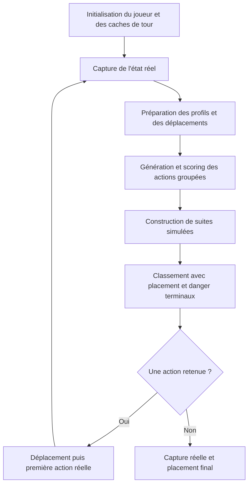

# IA LeekWars

IA orientée simulation : elle cherche une suite d’actions, joue la première, puis replanifie depuis l’état réel du combat.

Ce dépôt contient uniquement **`New_AI/`** et ce README, pour importer l’IA dans LeekWars sans embarquer les outils de développement.

## Utilisation

Le point d’entrée est [`New_AI/Main.leek`](New_AI/Main.leek). Importer le dossier `New_AI` en conservant son arborescence et les chemins des `include`.

Les modifications courantes du scoring se font sur **`main`**.

Ce document décrit le code de `main` au **13 octobre 2026**. Les valeurs indiquées
sont les réglages actuels, pas des paramètres validés pour tous les builds.

## Sommaire

- [Déroulement d'un tour](#déroulement-dun-tour)
- [Organisation du code](#organisation-du-code)
- [État virtuel et simulation](#état-virtuel-et-simulation)
- [Modifier le scoring](#modifier-le-scoring)
- [Projection du danger et des soins](#projection-du-danger-et-des-soins)
- [Placement final](#placement-final)
- [Coût des cooldowns](#coût-des-cooldowns)
- [Recherche de suites d'actions](#recherche-de-suites-dactions)
- [Budget d'opérations](#budget-dopérations)
- [Caches et invalidation](#caches-et-invalidation)
- [Diagnostics](#diagnostics)
- [TODO](#todo)
- [Limites actuelles](#limites-actuelles)
- [Mesures historiques](#mesures-historiques)
- [Documentation et outils](#documentation-et-outils)

## Déroulement d'un tour



1. `Main.leek` charge le catalogue et la géométrie au premier tour, puis appelle
   `ReloadCacheNewTurn` **avant** `Preload.InitStateClass`. Cette dernière fixe `Me`,
   l'inventaire, les catégories d'actions et le coût minimal d'un item disponible.
2. `Play` capture le combat avec `StateClass.Virtualize`. Les caractéristiques,
   cellules, effets et ressources réels deviennent les entrées de la décision.
   Le debug des coefficients s'affiche une fois au début du tour s'il est activé.
3. Le plafond de recherche réserve des opérations au placement et aux bulbes du
   propriétaire qui doivent encore jouer. Le plafond moteur vaut `getCores() × 1 000 000`.
4. `ActionSuite` prépare le contexte de scoring, le soutien allié, le potentiel
   offensif de placement et les quatre couches de déplacement de Me. Il calcule
   le score initial, génère les actions, puis développe des suites.
5. Les candidats terminaux sont comparés après soustraction de leur meilleure
   pénalité de placement. Un plan déjà complètement évalué avec danger est conservé.
6. `Play` exécute seulement la **première** action : rejoindre `From`, équiper
   éventuellement l'arme, puis lancer vers `To`. Invocation et résurrection ont
   leurs appels moteur propres ; l'ID à ressusciter est celui choisi en simulation.
7. Une action jouée entraîne une nouvelle capture et une nouvelle recherche.
   Une première erreur d'exécution replanifie ; une deuxième erreur identique,
   à cellule/ressources/arme identiques, arrête les actions et passe au placement.
8. Si le budget ne finance plus de recherche, `drainChain` tente la suite du dernier
   plan dans la marge autorisée, sans construire un nouvel arbre. Chaque déplacement
   et lancer peut échouer ; la vidange s'arrête alors. Elle n'est pas une revalidation
   complète de la suite contre les conséquences réelles des casts précédents.
9. À la sortie, `Play` capture une dernière fois le combat, appelle `FinalCell.get`
   et tente le déplacement final. Un échec est journalisé, sans nouvelle boucle.

Les **bulbes** invoqués avec `Bulb.AI` utilisent la même boucle de jeu. Ils partagent
la VM, les globals et le compteur d'opérations de leur invocateur : chacun réinitialise
les caches de tour avant de devenir `Me`. Les **plantes** utilisent `PlantPolicy`,
une politique courte lors des réveils ; elle ne relance pas `Play` et ne remplace
pas les globals du joueur dont l'action est interrompue.

## Organisation du code

| Ensemble | Fichiers principaux | Rôle |
| --- | --- | --- |
| Entrée | `Main.leek`, `includes.leek` | Chargement et lancement du tour. |
| Initialisation | `Load/Preload.leek`, `Constants.leek`, `Cache.leek`, `Binary_To_Cells.leek` | Catalogue moteur, constantes, tables de cellules/bitmaps, hashes et durée de vie des caches. |
| Entités et état | `Models/Entity.leek`, `EntityState.leek`, `State.leek` | Identité/inventaire, état courant, import des effets, clones et patches. |
| Géométrie et items | `Models/Item.leek`, `Cell.leek`, `Target.leek` | Métadonnées et vues d'effets, distances/zones/LoS, masques et catégories de cibles. |
| Actions | `Models/Action.leek`, `Maps/Actions.leek` | Actions concrètes, groupes d'origines, disponibilités et catalogues. |
| Déplacements | `Maps/WalkCells.leek` | Marche, Saut, Téléportation, combinaison, reconstruction et exécution du trajet. |
| Conséquences | `Modifier/Consequences.leek` | Effets des casts, protections, dégâts, passifs, registre d'effets et cascades de mort. |
| Invocations | `Modifier/BulbState.leek`, `Resurrection.leek`, `Awakening.leek` | Entités virtuelles, résurrection, politique des plantes et simulation des réveils. |
| Projection | `Maps/ItemCoverage.leek`, `Danger/*`, `Heal/Heal.leek`, `Delta/Delta.leek` | Couvertures, combos adverses, soin projeté et dégâts nets séquencés. |
| Valeur et placement | `Scoring/*` | Valeur d'état, coefficients manuels, frais de cooldown et pénalités de position. |
| Décision et exécution | `User/Node.leek`, `BFS.leek`, `FinalCell.leek`, `Play.leek`, `BulbAI.leek` | Simulation d'un nœud, recherche, clôture du plan et appels moteur réels. |
| Mesures | `Utils/Benchmark.leek` | Profilage facultatif des opérations par catégorie. |

## État virtuel et simulation

### Capture et registre d'effets

Un état est une map **`ID → EntityStateClass`**, comprenant les entités rendues par
le moteur, y compris les morts disponibles pour la résurrection. `EntityClass` porte
l'identité, le camp, l'inventaire et les propriétés d'entité ; `EntityStateClass`
ajoute les caractéristiques courantes, PV, ressources, arme, cooldowns, usages,
ordre de jeu et masque d'états.

Les **stats de base** sont séparées des valeurs modifiées par les effets. Le registre
`EFFECTS` conserve les lignes du moteur et leur datation. Il alimente les agrégats de
poison/contrecoup/soin continu, les sommes d'entraves et les sommes de buffs pondérées
par durée. L'expiration des boucliers a son propre profil daté : des stocks totaux
identiques peuvent protéger différemment pendant la fenêtre projetée.

### Construction d'un nœud

Pour chaque candidat, `NodeClass.ActionToNodeInTree` :

1. Ouvre un workspace partagé avec les autres candidats du même parent et clone Me.
2. Simule le trajet vers `From` : dépenses de PM/PT, cooldowns de mobilité et effets
   propres de Saut/Téléportation. Le buff d'agilité du Saut peut donc affecter le cast
   suivant ; la vitalité de Téléportation est appliquée avant ce cast.
3. Rejoue les réveils de plantes lorsque le déplacement simulé l'exige.
4. Dépense le coût total, équipe l'arme si nécessaire et applique les effets de l'item
   dans leur ordre, en clonant les autres entités à leur première mutation.
5. Met à jour cooldown/usages, captures des entités modifiées et empreintes de caches.
6. Calcule le delta de score sur ces seules entités, puis restaure le workspace.

Le nœud conserve un **patch**, pas une copie profonde de tout le combat.
`STATE_PARENT` est la chaîne d'états immuable ; `PARENT` sert à reconstruire la suite
d'actions retenue. `END_STATS` est matérialisé à la demande lorsque le nœud est développé
ou évalué au placement. Pour Me, cooldowns et usages utilisent aussi des patches reliés
à l'état précédent ; leurs setters invalident les mémos concernés.

Les conséquences couvrent notamment dégâts directs, poison, dégâts de vie/nova,
soins/vitalité, buffs, entraves, protections/vulnérabilités, renvoi, états, débuffs,
déplacements, invocations et résurrection. Les passifs implémentés, retraits d'effets
et cascades de mort passent par le même workspace. Les invocations virtuelles utilisent
des stats d'invocation et des IDs déterministes par type, distincts des IDs réels.
La résurrection choisit le mort allié ayant la meilleure valeur après simulation du relevé ;
elle transmet cet ID jusqu'au vrai cast et respecte la place requise pour relever un summon.

Cette simulation est **déterministe** : les casts de notre recherche utilisent la valeur
basse des effets et un critique binaire à partir de 950 agilité. Elle ne reproduit pas
les jets aléatoires d'un futur combat. La projection adverse utilise une convention
plus pessimiste, détaillée dans la section danger.

## Modifier le scoring

### Fichiers de réglage

Quatorze fichiers :

- [`Coefficients.leek`](New_AI/Scoring/Coefficients.leek) : coefficients bruts par statistique et deux multiplicateurs communs PT/PM.
- [`Importance.leek`](New_AI/Scoring/Importance.leek) : bonus de présence selon les caractéristiques utiles, les puces tactiques et les multiplicateurs de PT/PM.
- [`Equipment.leek`](New_AI/Scoring/Equipment.leek) : utilitaires de rendement de l'équipement, mis en cache par entité et par tour.
- [`StateConstants.leek`](New_AI/Scoring/StateConstants.leek) : proportions de cibles adverses/alliées en cache par `BaseHash`, et échelle du bonus critique.
- [`BuffDuration.leek`](New_AI/Scoring/BuffDuration.leek) : durée des buffs de force, agilité, sagesse, résistance, science et magie.
- [`Scoring.leek`](New_AI/Scoring/Scoring.leek) : potentiel courant des caractéristiques et de la tactique multiplié par PT/PM, puis autres contributions, alliés moins adversaires.
- [`Shackles.leek`](New_AI/Scoring/Shackles.leek) : décote des six entraves selon Manumission, synergies PT/PM comprises.
- [`ShieldProfile.leek`](New_AI/Scoring/ShieldProfile.leek) : profil offensif adverse grossier, calculé par camp et conservé dans le contexte de racine.
- [`PeriodicEffects.leek`](New_AI/Scoring/PeriodicEffects.leek) : avenir du poison/contrecoup, plafond de PV commun et décote Antidote du porteur, sans parcours des lignes d'effets.
- [`Debug.leek`](New_AI/Scoring/Debug.leek) : coefficients de chaque vivant au début du tour, avec une pause après toute la liste. `ScoringDebug.ENABLED = false` désactive l'affichage et les pauses ; coefficients bruts avant durée/PT/PM, potentiel courant, facteurs communs et leur produit sont affichés séparément.
- [`Placement.leek`](New_AI/Scoring/Placement.leek) : distances et exposition au danger, soustraites à la fin des suites d’actions.
- [`AllySupport.leek`](New_AI/Scoring/AllySupport.leek) : potentiel de buffs/boucliers alliés et coût de l'éloignement.
- [`EnemyOffense.leek`](New_AI/Scoring/EnemyOffense.leek) : potentiel offensif obtenu avec les conséquences et le scoring communs, puis décote hors portée.
- [`Cooldowns.leek`](New_AI/Scoring/Cooldowns.leek) : prix des cooldowns consommés et filtre de Régénération sans soin.

### Calcul du score

```text
Valeur(entité vivante) = max(0,
    importance de base + vie pondérée + vie maximale pondérée
    + potentiel courant × facteur PT × facteur PM + correction des entraves
    + boucliers + renvoi posé + flux périodiques)

Score(état) = somme des valeurs alliées − somme des valeurs adverses
Score(nœud) = Score(état simulé) − frais de cooldown cumulés dans le plan
Score terminal = Score(nœud) − meilleure pénalité de placement accessible
```

Une action est évaluée par différence avant/après. La racine score toutes les entités ;
les successeurs ne recalculent que celles clonées par l'action et réutilisent les valeurs
exactes du parent ou d'un ancêtre intact. Le danger projeté n'est pas un terme de
`entityValue` : la sécurité de Me est arbitrée à la clôture, dans `FinalCell`.

### Présence, vie et ressources

Une entité morte vaut zéro. Le bonus fixe de présence est remplacé par `EntityImportance.value(stat)` : **(caractéristiques utiles + tactique) × multiplicateur PT × multiplicateur PM**. Les poids et les paliers sont des valeurs de départ à régler manuellement dans `Importance.leek`.

Les coefficients de **vie et de vie maximale** utilisent chacun des tranches de points : les 1 000 premiers valent ×2, les points de 1 000 à 3 000 ×1,75, de 3 000 à 5 000 ×1,5, de 5 000 à 7 000 ×1,25, et ceux au-delà de 7 000 ×1. Les contributions des tranches s'additionnent, puis la somme est multipliée par `EntityImportance.value(stat) / 3000` pour la vie, et par `EntityImportance.value(stat) / 2000` pour la vie maximale. Le score reste continu aux seuils : un poids ne s'applique jamais rétroactivement à tous les PV.

`life` et `totalLife` rendent le coefficient moyen `importance / diviseur × points pondérés / points`, avec une garde pour les valeurs nulles ou négatives. Le scoring conserve ainsi son calcul avant/après. Pour une importance de 3 000, la perte de 9 000 à 8 000 PV rapporte 1 000 sur le terme de vie, celle de 2 000 à 1 000 rapporte 1 750, et celle de 1 000 à 0 rapporte 2 000, avant les autres contributions du kill. Les soins suivent la même courbe en sens inverse. La vie maximale utilise exclusivement `TOTAL_LIFE` pour ses tranches, sans dépendre des blessures courantes ; un gain de vitalité qui augmente à la fois vie et vie max valorise les deux deltas. Les deux fonctions ont les mêmes tranches, mais des diviseurs distincts (3 000 pour la vie, 1 500 pour la vie max), réglables séparément dans `Coefficients.leek`.

Le terme de **caractéristiques et ressources** est unique : `ScoringClass.characteristicsPotential(stat) × Coefficients.tpMultiplier(stat) × Coefficients.mpMultiplier(stat)`. Le potentiel additionne les caractéristiques **courantes**, pondérées par leurs coefficients bruts et les durées existantes, puis les poids tactiques des puces. Il est planché à zéro pour qu'un potentiel négatif ne récompense pas une perte de PT/PM. Aucun terme direct `TOTAL_TP × coefficient` ou `TOTAL_MP × coefficient` ne s'ajoute. Buffs de caractéristiques et buffs de ressources renforcent donc la même contribution ; à état final identique, le gain cumulé reste le même quel que soit l'ordre des buffs.

Les facteurs suivent `TOTAL_TP` et `TOTAL_MP`, **avec buffs/entraves, sans les dépenses du tour**. Ils sont continus par tranches, sans plateau final : chaque point positif supplémentaire garde une valeur. Réglages de départ dans `Coefficients.leek` :

- PT : chaque point jusqu'à 16 ajoute `1/16`, de 16 à 32 `1/32`, puis `1/64`. Facteurs : 0 PT → 0 ; 16 → 1 ; 32 → 1,5 ; 48 → 1,75.
- PM : socle `0,75`, puis chaque point jusqu'à 5 ajoute `0,05`, de 5 à 10 `0,025`, puis `0,01`. Facteurs : 0 PM → 0,75 ; 5 → 1 ; 10 → 1,125. Statique ou enraciné utilise toujours 0 PM : son potentiel reste valorisé, mais un buff de PM ne rapporte rien.

Ces facteurs s'appliquent une seule fois, **critique et tactique inclus**. Présence, vie, vie maximale, boucliers, renvoi déjà posé et flux périodiques restent hors du produit. Les caches d'équipement et de tactique sont réutilisés ; le potentiel courant est recalculé pour l'entité scorée, car il dépend des buffs. La décote Manumission compare ce même terme avec et sans les entraves. Les PT/PM ne sont toujours pas pondérés par la durée de leurs buffs ; les distances restent traitées par le placement.

La partie caractéristiques de l'**importance de présence/vie**, distincte de ce potentiel courant, utilise les **stats de base sans effets** (`BASE_STATS`), filtrées par les verdicts `Equipment.canUse*` déjà en cache. `EntityImportance.statScore` valorise chaque point de caractéristique par tranche : ×1 jusqu'à 200, ×1,5 de 200 à 400, ×2,5 de 400 à 600, puis ×3,5 au-delà. C'est un mélange à parts égales du score linéaire et d'un coût de capital normalisé (coût ×2), inspiré des [paliers de capital de Leek Wars](https://leekwars.com/encyclopedia/fr/Force). Il favorise les spécialisations sans saut aux seuils : à poids égaux, 900 + 300 valent 2 400 points contre 2 250 pour 500 + 500 + 500, avant tactique et multiplicateurs PT/PM. Ce n'est pas une estimation du capital réellement dépensé : les bases incluent aussi les [bonus de composants, exclus du coût de capital](https://leekwars.com/encyclopedia/fr/Les_Composants).

Force, sagesse, résistance, science et magie utilisent ce barème avec un poids de 1. L'agilité applique le même barème à sa part critique (plafonnée à 1 000 avant calcul, poids 0,3), puis à sa part renvoi (sans plafond, poids 0,7 si l'équipement peut en poser). Cela modifie l'importance, pas `Coefficients.criticalAgility` ni les coefficients de buffs. La puissance conserve son poids linéaire de 5, sans barème de capital ; sa base est reconstituée dans la passe d'import existante en retirant les `EFFECT_RAW_BUFF_POWER`, y compris permanents. Vie, boucliers posés, renvoi posé et effets périodiques sont exclus de cette importance. Buffs et entraves ne font plus varier le bonus de présence. Le résultat complet reste mémorisé dans `IMPORTANCE_MEMO` : les tranches sont calculées au premier appel, puis les clones réutilisent le résultat.

Les autres contributions de `ScoringClass.entityValue` restent basées sur l'état courant et leurs règles de durée. Un kill les retire déjà avec la valeur de l'entité : ajouter une différence « stats courantes − bases » compterait une seconde fois la disparition des buffs. Le changement ne retire pas les contributions des stats de base de ces autres termes ; il stabilise seulement le bonus de présence.

La partie tactique additionne les **poids fixes des puces possédées** : Inversion 70, Téléportation 120, Libération 120, Manumission 50, Gant de boxe 10, Grappin 10, Saut 60, Rempotage 20 et Hémorragie 60. Chaque poids se règle séparément dans `tacticalChipScore`, avant application des multiplicateurs de PT/PM. Elle concerne tous les porteurs ; elle ignore cooldowns et portées. Sa somme est mise en cache par ID et classe réelle/virtuelle, puis invalidée à chaque tour. L'importance complète est mémorisée dans un scalaire `IMPORTANCE_MEMO` de l'état, copié avec ses clones : bases, inventaire et caractère statique ne changent pas pendant la simulation. Une nouvelle capture réelle ou une nouvelle invocation virtuelle repart avec un mémo vide.

Les PT et PM multiplient toute cette importance et n'y ajoutent aucun terme fixe. Les paliers utilisent `BASE_STATS[STAT_TP]` et `BASE_STATS[STAT_MP]`, sans buffs/entraves ni dépenses. Le facteur PT vaut 0,5 sous 8, 0,8 dès 8, 1,2 dès 16, 1,6 dès 24 et 1,9 dès 32. Le facteur PM vaut 0,6 sous 2, 0,9 dès 2, 1,2 dès 4, 1,4 dès 6 et 1,5 dès 8 ; une entité statique utilise le palier de 0 PM, sans perdre toute son importance. L'enracinement courant n'intervient plus dans cette importance de base. Le debug affiche les deux composantes et les deux multiplicateurs de base en plus de la présence finale.

### Coefficients de caractéristiques et durée

Le coefficient de force utilise des **paliers sur la force courante** : base de 0,2, puis +0,2 au-dessus de 0, +0,3 dès 200, +0,3 dès 400, +0,2 dès 600, +0,2 dès 800 et +0,1 dès 1 000. Les coefficients cumulés sont donc 0,2, 0,4, 0,7, 1, 1,2, 1,4 et 1,5. Si `Equipment.strengthYield` est nul sur poireaux et invocations, le coefficient vaut toujours zéro. Le rendement et son cache sont conservés, mais leur amplitude et les proportions de cibles ne pondèrent plus ce coefficient. Les dégâts effectivement simulés sont déjà comptés dans la vie.

Pour les buffs additifs de force, d'agilité, de sagesse, de résistance, de magie et de science à durée positive, le multiplicateur vaut **durée restante** sur une autre entité et **durée restante − 1 + 0,01** sur Me (le porteur, pas forcément le lanceur). Sans entrave et à coefficient inchangé, un buff de +100 force pour un tour ajoute donc au potentiel `100 × coefForce` ailleurs et `1 × coefForce` sur Me ; pour trois tours, respectivement `300 × coefForce` et `201 × coefForce`. Le potentiel est ensuite multiplié par les facteurs communs PT/PM. Si un palier de force est franchi, le nouveau coefficient s'applique à toute la force valorisée de l'état après l'action. La règle utilise la durée brute `eff[3]`, sans plafond ; les effets permanents ou instantanés gardent leur valeur ordinaire. La sagesse a le même plancher à −100 que l'agilité (soin et vitalité utilisent `max(0, 1 + sagesse / 100)`) ; la résistance n'en a aucun, les boucliers la prenant telle quelle ; la magie est planchée à 0 comme la force ; la science n'a aucun plancher. Les autres statistiques ne sont pas encore pondérées par durée.

Deux scalaires par caractéristique conservent la somme brute des buffs et leur somme pondérée. Ils sont initialisés dans la passe d'import existante et maintenus à la pose, fusion, réduction, remplacement et suppression des effets ; la résurrection les remet à zéro. Les buffs de Saut et les passifs d'armes passent par les mêmes points d'enregistrement. Le scoring remplace la partie buff par sa valeur pondérée, sans multiplier le delta entier de l'action et sans parcourir les effets à chaque nœud. Si une entrave fait passer la force sous zéro, seule la partie positive est valorisée ; les durées des buffs qui la composent sont alors pondérées au prorata de leurs valeurs.

Le coefficient d'agilité part de la **base critique** décrite ci-dessous. Si `Equipment.damageReturnYield` est nul sur poireaux et invocations, il conserve uniquement cette base. Sinon, il ajoute les mêmes paliers que la force, sur l'agilité courante : +0,2 au-dessus de 0, +0,3 dès 200, +0,3 dès 400, +0,2 dès 600, +0,2 dès 800 et +0,1 dès 1 000. Le rendement sert seulement à détecter un renvoi lançable ; sa valeur et les proportions d'alliés ne pondèrent plus le coefficient. Le debug affiche le coefficient total et rappelle la base critique déjà incluse.

Le coefficient de sagesse part d'une base de 0,2, puis ajoute +0,2 au-dessus de 0, +0,3 dès 200, +0,3 dès 400, puis +0,1 dès 500, 600 et 700. Il vaut zéro si `Equipment.healYield` (soin, instantané ou par tour) et `Equipment.boostMaxLifeYield` (vitalité), les deux seuls effets multipliés par la sagesse, sont nuls sur poireaux et invocations. Chaque rendement compte ses effets lancés sur un allié ou sur soi ; le soin brut, indépendant de la sagesse, n'y entre pas.

Le coefficient de résistance reprend les paliers de la sagesse, sur la résistance courante. Il vaut zéro si `Equipment.absoluteShieldYield` (en PV) et `Equipment.relativeShieldYield` (en %), les deux seuls effets multipliés par la résistance, sont nuls sur poireaux et invocations. Chaque rendement compte ses effets lancés sur un allié ou sur soi ; les boucliers bruts n'y entrent pas.

Le coefficient de magie reprend les paliers de la force, sur la magie courante. Il vaut zéro si aucun effet multiplié par la magie n'a de rendement, sur poireaux et invocations : `Equipment.poisonYield` et les six entraves (`shackleStrengthYield`, `shackleMagicYield`, `shackleAgilityYield`, `shackleWisdomYield`, `shackleTpYield`, `shackleMpYield`), tous lancés sur un ennemi. Une seule suffit : un allié qui n'empoisonne pas mais entrave la force garde un coefficient. Chaque coefficient interroge son verdict mis en cache (`Equipment.canUseStrength`, `canUseDamageReturn`, `canUseWisdom`, `canUseResistance`, `canUseMagic`, `canUseScience`, `canUsePower`, et pour les parts de la puissance `canUsePoison`, `canUseNovaDamage`, `canUseLifeDamage`) plutôt que ses rendements, relus seulement au premier appel du tour.

Le coefficient de science reprend les paliers de la force, sur la science courante. Il vaut zéro si aucun effet multiplié par la science n'a de rendement, sur poireaux et invocations : les six buffs (`buffStrengthYield`, `buffAgilityYield`, `buffWisdomYield`, `buffResistanceYield`, `buffTpYield`, `buffMpYield`) et `novaVitalityYield`, lancés sur un allié ou sur soi, puis `aftereffectYield` et `novaDamageYield`, lancés sur un ennemi. Le verdict est mis en cache par `Equipment.canUseScience`.

Le coefficient de puissance vaut zéro si `Equipment.canUsePower` est faux. Sinon, il somme une part par famille d'effets multipliée par la puissance, puisqu'une même entité peut les cumuler (une arme de force et un poison, par exemple). Chaque part ne compte que si l'équipement peut lancer sa famille, et reprend les paliers de la force sur sa propre stat : `powerStrengthPart` sur la force (dégâts), `powerMagicPart` sur la magie (poison, sans les entraves), `powerSciencePart` sur la science (dégâts nova) et `powerLifeDamagePart` sur la vie courante (châtiment), avec des paliers tous les 1 000 PV. Comme les autres coefficients, cette somme ne contient plus de multiplicateur PT interne. La puissance n'est pas pondérée par la durée : ses gains sont aujourd'hui permanents.

Réciproquement, la force, la magie et la science reçoivent un bonus de puissance, ajouté à leurs paliers avant le multiplicateur de PT : +0,2 dès 20 de puissance, +0,5 dès 50, +1 dès 100 et +2 dès 200 (valeurs cumulées). La force le reçoit toujours ; la magie seulement si `canUsePoison`, et la science seulement si `canUseNovaDamage`, la puissance n'amplifiant ni les entraves ni les buffs.

Les anciens multiplicateurs PT propres à chaque caractéristique sont supprimés. Les coefficients bruts restent réglables séparément, tandis que `tpMultiplier` et `mpMultiplier` règlent l'effet commun des ressources. Aucune distance n'entre dans ces coefficients ; elle reste traitée par le placement final.

Le scoring soustrait cette base du coefficient total pour valoriser séparément le renvoi et le critique, sans compter deux fois ce dernier. La contribution de renvoi conserve le plancher à **−100** d'agilité ; le critique conserve sa plage **[0, 1000]**. Un franchissement de palier modifie le coefficient de toute l'agilité valorisée pour le renvoi, comme pour la force.

**Critique :** les points d'agilité utiles sont limités à **[0, 1000]**, conformément à la probabilité moteur `agilité / 1000`, puis pondérés par la durée des buffs. Le coefficient brut vaut désormais `0,16 × (1 + max(0, meilleure caractéristique de base) / 100)`, avec le maximum de force, magie, sagesse, science et résistance. La constante 0,16 conserve l'ancien coefficient à 16 PT et 5 PM, où les facteurs communs valent 1. L'échelle de puissance du porteur reste mémorisée sur l'entité, car `BASE_STATS` est immuable. Les ressources interviennent ensuite une seule fois dans le produit commun : un gain de PT ne multiplie pas deux fois le critique. Avec une meilleure base de 400, le coefficient brut vaut 0,8 ; à 14 PT et 5 PM, son coefficient après facteurs communs vaut 0,7. Le renvoi et le critique suivent tous deux la même règle de durée ; en cas de buffs de durées différentes franchissant un plancher ou plafond, la partie utile est répartie au prorata de leurs valeurs.

Les poids sont les proportions exactes parmi les adversaires vivants : 60 % d'invocations donnent 40 % poireaux / 60 % invocations ; aucune invocation donne 100 % poireaux / 0 % invocations. Sans aucun adversaire vivant, les deux poids valent zéro. `StateConstants.leek` calcule ces proportions par camp (BR inclus) et conserve le résultat par `BaseHash` au sein du tour. Le BFS prend le contexte de sa racine avant tout score, résurrection incluse, puis le fige pour tout l'arbre. Une mort simulée ne revalorise pas les porteurs non modifiés ; une action réelle fournit le contexte de la nouvelle racine à la recherche suivante.

Ce rendement considère une cible au centre de la zone, au coût nominal de l'item ; il ignore cooldowns, limites d'usage, portée, équipement de l'arme, protections et multiplicateurs du porteur. Les lignes d'un même cast s'additionnent, mais pas les armes entre elles. Puces et armes sont couvertes ; Châtiment, poison, nova et dégâts sur soi sont exclus. C'est une estimation simple du potentiel futur, pas une prévision de dégâts réalisables au tour courant.

Les fonctions de coefficient ne doivent dépendre que de leur état `stat`, du catalogue immuable et du contexte figé à la racine pour conserver le calcul incrémental. Les caches d'équipement stockent des `EquipmentYield` sans pondération, par ID et classe réelle/virtuelle, et supposent l'inventaire constant au sein d'une recherche. Le contexte `ScoringStateConstants` contient un `TargetWeights` adverse et allié par camp ; rendements et poids exposent les champs nommés `LEEKS` et `SUMMONS`. Son cache par `BaseHash` s'utilise sur les racines réelles, où Me est vivant, et est vidé au début du tour de chaque joueur. Les caches de scores restent locaux à la recherche. Les pénalités de placement doivent rester positives ou nulles ; si leurs entrées changent, adapter aussi les clés de cache.

### Protections et renvoi

Le **bouclier absolu** vaut `valeur par tranches × importance de base / 3000 × facteur adverse`. Les 100 premiers points valent 2 chacun, les points de 100 à 300 valent 1,5, ceux de 300 à 600 valent 1, puis 0,5 au-delà. Les tranches s'additionnent ; une vulnérabilité absolue (stock négatif) garde une valeur signée linéaire de 2 par point. `Coefficients.absoluteShield` renvoie le coefficient moyen puisque le scoring multiplie déjà par le stock. Ces poids restent hors du facteur commun PT/PM ; durée et interaction avec le bouclier relatif ne sont pas estimées dans ce terme.

Le **bouclier relatif** suit le même poids d'importance et de profil adverse, avec une échelle par point de pourcentage : 10 pour les 30 premiers points, 8 de 30 à 60, puis 5 de 60 à 100. Le stock valorisé est limité à 100 pour cette estimation de protection ; ce n'est pas une limite du moteur. Une vulnérabilité relative garde une valeur signée de 10 par point. Le **renvoi de dégâts** utilise aussi ce poids : 5 pour les 50 premiers points, 10 de 50 à 100, 8 de 100 à 200, puis 3 au-delà, sans plafond. Il ne dépend ni des PV courants du porteur ni de ses boucliers, puisque le moteur calcule le renvoi avant les protections.

Les deux boucliers reçoivent un **bonus additif de protection à faible vie**, séparé du barème de stock. Les fonctions `absoluteShieldLifeBonus` et `relativeShieldLifeBonus` sont réglables indépendamment dans `Coefficients.leek`. À 3 000 PV ou plus, le bonus est nul ; à 2 000 PV, il vaut respectivement 0,1 et 1 par point ; à 1 000 PV, 0,25 et 2,5 ; à 0 PV, 0,5 et 5. Entre ces repères, les tranches se remplissent progressivement, sans saut de score. Le bonus absolu porte uniquement sur les 600 premiers points, et le relatif sur les 100 premiers ; avec ces valeurs de départ, leur revalorisation cumulée reste inférieure à la perte du terme de vie lorsque le porteur subit des dégâts. Les vulnérabilités n'en bénéficient pas. Le debug affiche ces bonus bruts avant importance et profil adverse. Une entité morte reste toujours à zéro dans le scoring.

Le **facteur adverse** de `ShieldProfile` oppose deux poids de profils offensifs : attaques de force/Châtiment, et poison/nova/contrecoup. Les inventaires sont filtrés par les utilitaires d'équipement en cache. Force, magie et science de BASE donnent un poids de 0 sous 100, 0,25 dès 100, 0,5 dès 200, 1 dès 400 et 1,5 dès 800 ; Châtiment garantit un poids de 1 dans le canal sensible aux boucliers. Chaque entité peut contribuer aux deux canaux, mais seule sa meilleure famille compte dans chacun. Les purs soutiens n'ajoutent aucun poids. Les vivants, invocations incluses, sont regroupés par camp, et tous les autres camps sont considérés adverses en BR.

Si au moins 66 % du poids offensif adverse est sensible au bouclier, le facteur vaut 1 ; à partir de 25 %, il vaut 0,6 ; sinon 0,25, y compris sans menace significative identifiée. Ce même facteur oriente les deux boucliers et le renvoi. Les poids et seuils se règlent dans `ShieldProfile.leek`. C'est une orientation grossière : aucune portée, distance, combinaison d'attaques ou disponibilité de puce n'est calculée. Le résultat est conservé par `BaseHash` dans `ScoringStateConstants` et **figé pendant tout le BFS**, pour ne pas revaloriser des entités non clonées lors d'une mort simulée. Une nouvelle racine réelle actualise le contexte si les vivants changent. Le debug affiche le facteur en plus des coefficients finaux.

### Effets périodiques

Les **dégâts périodiques futurs** ont le même poids par PV pour poison et contrecoup, multiplié par `importance de base / 3000`. Les ticks valent successivement **1 ; 0,8 ; 0,6 ; puis 0,4 pour tous les suivants**, réglables dans `Coefficients.periodicTickWeight`. Les agrégats `*_OVER_TIME` contiennent déjà les durées ; aucune multiplication supplémentaire ne s'ajoute. Les prochains ticks `POISON` et `AFTEREFFECT` donnent la taille des trois premiers morceaux ; tout le stock restant utilise le dernier poids. C'est une approximation lorsque plusieurs lignes ont des durées différentes.

Poison et contrecoup partagent les PV actuels : le budget est consommé du prochain tick vers les suivants, avant la décote d'avenir. Si un morceau dépasse les PV disponibles, les deux effets se partagent ce morceau au prorata. Le dégât immédiat du contrecoup est déjà dans `LIFE` ; seule sa suite entre ici. Le poison est ignoré sous invincibilité, tandis que les ticks de contrecoup déjà posé ne vérifient pas cet état dans le moteur.

**Antidote** conserve une part de **0,4 / 0,6 / 0,8 / 1** pour les cooldowns effectifs **0 / 1 / 2 / ≥3 ou inutilisable**, réglable dans `Coefficients.antidoteMultiplier`. Le mémo existant du cooldown brut est réutilisé et invalidé dès `StateClass.setCooldown`. Pour les autres porteurs, le cooldown est décrémenté d'un au prochain tour ; Me utilise le cooldown courant. Une puce absente ou une capacité `TOTAL_TP` inférieure à son coût donne le facteur 1, comme Manumission. Les dépenses du tour, la portée et l'aide de la team ne sont pas évaluées dans cette heuristique.

Les autres porteurs encaissent leur premier tick avant de pouvoir se nettoyer ; Me peut éviter aussi le premier. Lorsque poison et contrecoup coexistent, deux projections de coût fixe sont mélangées : poison conservé et poison nettoyé. Chacune a son plafond de PV, pour que les PV non consommés par un poison nettoyé restent disponibles au contrecoup. La projection commune est calculée une fois par entité scorée ; les coefficients moyens sont rendus à Scoring, qui les multiplie par leurs stocks comme auparavant. Aucun appel moteur ni boucle par ligne ou par tour de durée n'est ajouté.

Repères pour 100 PV de poison par tick, importance 3 000 et PV suffisants : trois ticks valent **156 / 184 / 212 / 240** chez un autre porteur selon Antidote ; chez Me, **96 / 144 / 192 / 240**. Sans Antidote, douze ticks valent **600**. Avec seulement 150 PV, ces douze ticks valent **140** sans Antidote, **116** chez un autre porteur avec Antidote disponible. Le **soin continu** reste `HEAL_OVER_TIME × 0,5 × importance / 3000`, neutralisé sous `UNHEALABLE`, sans plafond aux PV manquants actuels ni décote d'avenir. Ces termes restent hors des multiplicateurs courants PT/PM. Le debug affiche cooldown/facteur Antidote et les contributions futures.

## Projection du danger et des soins

La projection sert à départager les **placements terminaux de Me**. Le scoring
courant ne calcule pas un danger pour chaque entité à chaque nœud. Les API générales
de `Danger`, `Heal` et `Delta` restent disponibles, mais ne sont pas ajoutées aux
contributions de `ScoringClass.entityValue`.

### Menace adverse

1. `EntityDanger` retient les items offensifs de chaque adversaire vivant hors Me
   dont le cooldown permet un lancer au prochain tour (`<= 1`). Les vues d'effets
   précompilées distinguent cible poireau/invocation et masques applicables.
   Le canal de dégâts retient `EFFECT_DAMAGE`, `EFFECT_LIFE_DAMAGE` et `EFFECT_POISON` ;
   le canal de préparation retient les vulnérabilités et les deux types de débuff.
2. `WalkCells` fournit les paliers marche, Saut, Téléportation et combinaison,
   selon la mobilité et les ressources projetées. Les coûts des casts de déplacement
   sont retirés du budget ; les auto-buffs de PT pris en charge peuvent l'augmenter,
   en tenant compte des effets déjà portés et de leur expiration.
3. `ItemCoverage` partage les géométries par déplacement, portée et zone. La liste
   des items atteignant **une cellule donnée** est assemblée à la demande, avec la
   meilleure distance de zone disponible. On ne construit pas tous les combos du plateau.
4. `DangerCombo` empile les attaques par rendement dégâts/PT dans le budget et
   les limites d'usage. Il essaie d'abord les vulnérabilités/débuffs lorsque leur coût
   améliore le combo. C'est un choix glouton, pas un knapsack exhaustif.
5. `DangerPlan` partage le plan entre les cibles d'un même camp. `Danger` déroule
   les adversaires dans l'ordre pertinent pour la cible ; les boucliers après une
   vulnérabilité/débuff et leurs expirations affectent les attaquants suivants.
   Les couches de déplacement admissibles sont comparées pour conserver le danger retenu.

Les effets offensifs projetés prennent leur **valeur haute**. Le critique adverse
est craint dès **50 agilité** ; nos casts et les soins alliés ne prennent le critique
qu'à **950**. Le saut peut changer la classe critique du palier considéré. Les
coefficients globaux `DANGER_COEF` et `HEAL_COEF` valent actuellement **1**.
Cette convention pessimiste est volontairement différente de la simulation de nos casts.

La fenêtre place les lanceurs sur un cycle de jeu ; elle n'est pas une prédiction
exclusivement faite de dégâts directs sur ce cycle. Une contribution de **poison
nouvellement projeté** peut condenser plusieurs ticks, selon sa durée et Antidote.
Les flux déjà posés restent valorisés séparément par `PeriodicScoring`.

### Soin et dégâts nets

`HealClass` estime ce qu'un soigneur peut poser sur une cellule en soin instantané
et en vitalité, avec valeur basse, sagesse, masques poireau/invocation, paliers de
mobilité et budget glouton de PT/usages. Me est exclu : ses soins sont déjà simulés
par le BFS. Le soin continu ne devient pas un cast instantané de la heal map.

Le placement de Me prépare **seulement les soigneurs de son camp**. L'API complète
peut préparer les deux camps pour les projections d'autres cibles. Les couvertures
restent séparées par soigneur pour ne pas additionner aveuglément tous les soins
avant les dégâts.

`DeltaClass.netDamage` déroule l'ordre jusqu'au prochain tour de la cible, cible
exclue : dégâts adverses, puis vitalité et soin alliés aux créneaux correspondants.
La vitalité augmente d'abord le cap et, si la cible est soignable, ses PV ; le soin
ordinaire est plafonné à ce cap. Un mort ne reçoit plus de soin et les dégâts
suivants gardent leur overkill. Le résultat est `max(0, PV initiaux - PV finaux)`.
`UNHEALABLE` bloque le soin et le gain de PV de vitalité dans cette projection.

Le danger **brut** conserve la somme des menaces après protections, avant ces soins.
Brut et net sont mis en cache séparément ; ils alimentent ensemble la pénalité
ci-dessous. L'aide de la heal map est un potentiel, pas une promesse que l'allié
choisira effectivement de soigner cette cellule.

## Placement final

Pour chaque état terminal finançable, `FinalCell.evaluate` parcourt les cellules
accessibles dans sa mobilité courante et minimise :

```text
Pénalité(cellule) = coût du soutien allié perdu
                 + coût du potentiel offensif perdu
                 + risque brut/net pondéré par mon importance de base
```

Le score de la suite devient son score brut moins cette pénalité minimale. Les
pénalités restent positives ou nulles : un candidat dont le score brut ne dépasse
plus le meilleur score terminal validé peut être écarté sans calculer son danger.
Pendant le balayage, le coût spatial seul permet aussi d'écarter une cellule déjà
plus chère que le meilleur total trouvé. Ces deux coupures utilisent cette
non-négativité ; elles sont distinctes de la coupure gloutonne approximative des actions.

Un balayage interrompu retourne un résultat marqué **tronqué**. Il n'entre pas dans
le cache des placements complets et ne qualifie pas un nouveau plan comme pleinement
validé avec danger. Le placement réel recalcule sur la dernière capture du combat,
au lieu de suivre aveuglément la cellule terminale d'une ancienne simulation.

Le **danger de placement** utilise la fraction des PV courants menacée : les 10 premiers % ne coûtent rien, puis les tranches 10–40 %, 40–70 %, 70–100 % et au-delà de 100 % ont respectivement les poids 1, 2, 4 et 20. Les tranches s'additionnent sans saut aux seuils. `Placement.dangerRisk` règle ce barème ; sa valeur est multipliée par l'importance de base du porteur.

Le soin atténue ce risque : **pénalité = importance × (0,4 × risque brut + 0,6 × risque net)**. `Placement.HEAL_ATTENUATION = 0.6` règle la part effaçable par les soins. Le danger brut est pris après les protections et avant les soins ; le net réutilise l'ordre de jeu, le plafond de vie et l'impossibilité de soigner un mort. Aucun soin ne donne de bonus autonome : même avec un net nul, 40 % du risque brut reste compté. Pour 3 000 PV et une importance de 3 000, 1 000 dégâts coûtent 700 sans soin, 340 avec 600 soins utilisables et 280 s'ils sont entièrement compensés. La somme brute est mise en cache par clé de danger, sans reconstruire la carte. Le soutien allié et le potentiel offensif forment le coût spatial décrit ci-dessous.

Le **choix terminal du BFS** intervient après l'expansion, sans validation de danger
à la racine ni aux fins de branches. Les candidats sont triés par score brut décroissant,
puis évalués avec le placement jusqu'à ce que leur score brut ne puisse plus battre le
meilleur score final, ou que la garde du tour arrête le travail. Seules les évaluations
complètes participent au choix. Sans candidat entièrement évalué, la recherche rend
`null`, vide sa suite et affiche `[BFS] danger not taken into account: no affordable
terminal plan, stop actions`. Elle ne lance plus une action choisie au score brut seul.

Au placement final, le vrai repli sans danger affiche `[placement] danger not taken into account: spatial cost only`. Un résultat complet déjà en cache reste utilisé et ne produit pas cet avertissement. Ce repli n'ajoute aucune estimation de danger par nœud ; les réserves sont détaillées dans la section budget.

Le **placement près des alliés** dépend du soutien qu'ils peuvent apporter à Me, dans `Scoring/AllySupport.leek`. Aucun soin n'y est ajouté : la heal map le compte déjà. Les buffs utiles sont filtrés selon l'équipement de Me et les masques de cible ; les effets réservés au lanceur sont exclus. Une famille scientifique vaut 20, puis +20 à 200 science de base, +20 à 400 et +10 à 600. Les boucliers suivent les mêmes seuils en résistance de base. Les buffs bruts ont leurs propres poids fixes, sans science ; force 20, agilité 15, sagesse/résistance/magie/science 20, puissance/PT 30, PM 15. Les boucliers bruts valent 20 sans résistance.

La meilleure possibilité compte dans chacune des trois familles (buff scientifique, buff brut, bouclier), puis les alliés s'additionnent. Les poids de portée sont **1 sur place, 0,6 après marche, 0,4 avec Saut et 0,3 avec Téléportation**. Chaque item garde ensemble son potentiel, sa portée et son coût. Les cooldowns doivent être disponibles au prochain tour (≤ 1), et les PT totaux doivent financer le déplacement et le soutien, changement d'arme éventuel inclus. La distance géométrique ignore obstacles, LoS, portée minimale et formes de lancer ; il n'y a pas de recherche de combinaison de casts ni de nouvelle carte de mobilité.

Les profils sont mis en cache et figés à chaque racine réelle. Le balayage ne relit pas les inventaires : une lecture par distance et allié suffit. Le coût vaut le potentiel de référence moins le soutien accessible, toujours positif ou nul ; tuer un soutien en branche ne réduit pas la référence. Nouvelles invocations, buffs de mobilité et disponibilités sont actualisés au replan réel suivant. Les clés du coût spatial et de `FinalCell` portent ce contexte, car `BaseHash` seul n'encode pas les cooldowns et les PT/PM. Le potentiel offensif ci-dessous remplace le barème fixe de distance ennemie.

La **distance aux ennemis** utilise `Scoring/EnemyOffense.leek` et remplace la préférence fixe pour cinq cases. À la racine réelle, chaque item disponible au prochain tour est simulé sur un ennemi isolé supposé à portée, avec les conséquences communes et le delta de score du BFS. Le gain utilise donc les protections, les PV, le poison/Antidote, les entraves, les passifs et les cascades de mort déjà implémentés. Les auto-buffs seuls et leur contrecoup ne créent pas de potentiel offensif. Les valeurs d'avant-cast sont réutilisées dans un cache réservé à ces simulations indépendantes ; le BFS conserve ses propres mémos par parent simulé, avec les mêmes formules.

Le gain d'un cast est multiplié par `min(MAX_USES, floor((TOTAL_TP − équipement) / COST))`. Le changement d'arme coûte un PT une seule fois ; une puce qui déclenche un cooldown est limitée à un lancer, et un cooldown courant supérieur à un exclut l'item du prochain tour. Les PT restants et les usages déjà dépensés ce tour ne servent pas à cette estimation. Multiplier le premier gain reste une approximation : aucune chaîne de lancers répétés n'est simulée, notamment après un kill ou pour un effet non cumulable.

La décote vaut **10 % par case hors de la plage MINRANGE–MAXRANGE**, plafonnée à 100 %, réglable avec `RANGE_PENALTY_PER_CELL`. Dans la plage, le gain reste entier ; trois cases trop loin ou trop près conservent 70 %. Aucun PM, Saut ou Téléportation n'élargit cette plage. Chaque cellule garde le meilleur gain décoté parmi les couples item/ennemi, et son coût vaut le meilleur gain à portée moins ce gain accessible. Les ennemis morts sont retirés des deux maxima ; sans cible offensive, le coût vaut zéro. `OFFENSE_DISTANCE_WEIGHT = 1` règle l'échelle de cette pénalité. Un poids ou une décote à zéro désactive ce terme.

Les profils restent figés dans les branches, avec positions et morts lus depuis l'état simulé. La simulation suppose une seule cible au centre, sans zones, LoS ni évolution des ennemis/effets avant le prochain tour. Une empreinte de l'état réel, registres et cooldowns compris, protège le cache de préparation et les clés de placement. Le balayage ne simule rien : une lecture par ennemi et distance suffit. La préparation dispose de 200 000 opérations au maximum prévu, sans entamer la réserve de placement ; elle s'interrompt entre casts avec une marge de 20 000. Le coût d'un cast indivisible peut dépasser cette marge. Une préparation partielle affiche `[placement] offensive potential truncated: operation budget`, reste figée pour sa racine et n'entre pas dans le cache des profils complets.

Quand tous les gains sont entièrement décotés, `FAR_DISTANCE_WEIGHT = 0.2` conserve une **petite pente de rapprochement**. Le surcoût vaut 0,2 par case au-delà de la plus longue portée utile sur une cible, plus les dix cases de décote (avec le réglage de 10 %). On prend le plus petit dépassement parmi les ennemis vivants ayant un potentiel offensif. Avec une portée maximale utile de 7, une distance de 17 n'ajoute rien, 22 ajoute 1 point, 27 ajoute 2 points. Ce coût n'est pas plafonné ; il ne modifie pas le score dans la plage normale. Sans cible offensive vivante, il reste nul. Le réglage à zéro désactive uniquement cette petite pente.

## Coût des cooldowns

Les **coûts de consommation des cooldowns** se règlent dans `Scoring/Cooldowns.leek` : Régénération **300**, Élévation **150**, Résurrection **200** ; Antidote **20** seulement si la pression adverse de poison atteint **1**, Manumission **20** seulement si celle des entraves atteint **1**. Les autres items valent zéro. Une puce sans cooldown ne paie rien. Le prix appartient au cast et s'ajoute aux frais des casts précédents dans la suite du BFS ; une replanification réelle repart du score de l'état, sans refacturer les consommations passées. `EnemyOffense` utilise le même prix avant de multiplier le gain par les usages possibles.

Les pressions sont calculées par camp dans le contexte de racine et mises en cache avec `ScoringStateConstants`. Un adversaire vivant équipé de poison ou d'une des six entraves apporte **0,25 / 0,5 / 1 / 1,5** selon sa magie de **base ≥ 100 / 200 / 400 / 800**. Les deux familles sont indépendantes : un pur empoisonneur ne compte pas dans les entraves. Un hybride contribue aux deux, les alliés sont exclus, et tous les autres camps comptent en BR. Les seuils se règlent séparément ; aucun inventaire ni registre d'effets n'est parcouru par nœud pour calculer ces pressions.

Un filtre ciblé empêche **Saut + Régénération sans soin** de se qualifier uniquement grâce au buff du Saut. Il examine le soin possible après le déplacement, avec masques, PV manquants, sagesse, critique et `UNHEALABLE`. Le soin propre du passif critique d'Unstable Destroyer reste autorisé lorsqu'il est utile. Une puce sous son prix de cooldown reste différée. Sur cette branche expérimentale, une ancienne estimation non positive n'est pas réexaminée dans les successeurs ; la prochaine racine réelle rescore ses actions. Les valeurs d'entité et d'importance gardent leurs coefficients habituels.

## Recherche de suites d'actions

La branche expérimentale **`search-beam`** utilise un beam search de largeur
**automatique, de 1 à 12**. Cette largeur est choisie après la préparation de racine,
selon le nombre d'actions scorées, les PT restants, leur coût moyen et les opérations
disponibles, puis reste la même
à toutes les profondeurs de cette décision. Chaque parent propose au plus ce nombre
de successeurs réellement jouables et de gain positif ; les meilleurs états de cette
nouvelle vague continuent dans la même limite. Le classement entre parents
compare le score absolu des états, pas seulement le gain de la dernière action.
La recherche ne développe pas exhaustivement toutes les combinaisons. L'état « ne rien
jouer », toutes les racines positives et tous les successeurs proposés restent des
candidats terminaux, même s'ils ne continuent pas dans le beam.

La **recherche d'actions** regroupe les couples de lancement `From → To` par item,
cibles réellement concernées et distances dans la zone. Chaque groupe conserve ses
origines, puis est scoré après dédoublonnage. Les actions personnelles, les invocations
et les casts dans le vide sont recréés depuis la cellule du nœud : après un tir depuis
X, un auto-buff part de X, même si la recherche avait commencé en Y. Ils n'allouent pas
une map couvrant toutes les cellules accessibles. Les zones visant aussi un allié
gardent leurs origines et leurs différentes distances d'effet ; les lasers utilisent
toute leur ligne, pas seulement leur cellule de visée. Les effets de déplacement
conservent une signature géométrique distincte, car les mêmes cibles peuvent finir
sur des cellules différentes.

Le BFS préfère l'origine actuelle lorsqu'elle existe dans un groupe ; sinon il choisit
une origine accessible avec le même ordre de coût qu'avant, en gardant assez de PT pour
le cast et l'équipement. Les cooldowns, usages et coûts sont relus dans chaque branche.
Le domaine consulté suit la mobilité courante : un gain de PM ou l'accès au Saut
peut créer de nouvelles origines, sans se limiter aux cellules de la racine.

Les gains mémorisés par signature survivent aux changements de `BaseHash` dans une
recherche : seuls les nouveaux groupes sont simulés pour construire leur priorité.
Une zone qui gagne une cible a une nouvelle signature et est encore simulée en entier ;
il n'y a pas de cache additif par cible. Les gains réutilisés sont des **estimations de
classement**, pas des majorants : chaque candidat examiné est simulé et rescorré dans
son parent réel, avec les buffs/passifs du déplacement. Le classement et sa coupure
gloutonne restent approximatifs après une modification de stats. Le debug `[BFS] group
scores: … computed, … reused, … cached orders` rend cette réutilisation visible.

La géométrie est conservée **par plateau et item**, avec les origines déjà calculées.
Un déplacement ou un changement de PM complète uniquement les nouvelles cellules ;
les domaines déjà couverts ne sont pas reconstruits. La disponibilité d'un item reste
vérifiée dans l'état courant, sans figer les cooldowns ou le budget dans ce catalogue.
Une seule visée légale par origine et groupe est conservée ; les zones équivalentes et
les rayons de laser déjà traités évitent aussi leurs vérifications de LoS redondantes.
Les actions ponctuelles et les zones ordinaires sont produites directement, sans
construire une map intermédiaire pour chaque couple origine/visée. Pour une zone,
l'empreinte des autres entités est calculée une fois par centre, puis celle du lanceur
est ajoutée à sa distance propre depuis chaque origine.

Dans les successeurs, le tri réutilise des **clés et des priorités**, jamais des nœuds ni
des actions concrètes d'une ancienne branche. En mode gain brut, le choix d'origine
n'est effectué que pour les nouveaux groupes à scorer et les candidats examinés.
Son cache porte le plateau, la mobilité et les seuils de PT restant **après** le coût du
cast/équipement : un ancien échec faute de PT ne bloque pas une origine devenue payable.
Le mode rendement ajoute aussi les coûts courants à la clé du tri.

Les coûts et usages disponibles sont mémorisés sur l'entité simulée. Le mémo est
invalidé au clone et aux écritures de cooldown/usages ; un changement de PT ou d'arme
le remplace également. Le stock brut d'usages jouables est repris depuis le parent
immuable, en retirant les items écrits dans les patches locaux ; coût d'équipement et
financement par les PT restent courants. Chaque phase géométrique retrouve ce mémo
une fois avant sa boucle d'items.

Deux branches sœurs peuvent partager ce mémo seulement depuis le même mémo parent,
avec les mêmes PT, arme et vecteurs locaux de cooldown/usages. Le hash présélectionne,
puis les vecteurs de scalaires sont comparés exactement. Deux stocks indisponibles
ne suffisent jamais à établir cette égalité : leurs cooldowns/usages cachés peuvent
différer. Ce cache est borné à 64 enfants par mémo. Le masque d'items disponibles
n'est publié qu'après lecture complète de l'inventaire ; les scores et origines sont
toujours résolus par la recherche de main. Chaque nœud conserve
aussi les valeurs exactes des entités déjà scorées : ses candidats réutilisent les
valeurs d'avant-cast et calculent celles d'après-cast avec les mêmes formules.

Le mémo `SCORE_MEMO` évite aussi de recalculer la valeur complète d'un clone dont
les inputs de score n'ont pas changé. Une simple dépense de PT/PM ou un changement
d'arme n'invalide pas cette valeur ; les capacités totales, caractéristiques, puissance,
protections, PV, états, durées pondérées, entraves et cooldowns de nettoyage pertinents
sont comparés exactement. Le contexte de scoring doit être le même. Les objets scorés
sont immuables ; les conséquences écrivent leurs clones. Tout nouvel input ajouté au
scoring doit aussi entrer dans `sameEntityScoreInputs`.

À la racine, les actions locales sont scorées avant la génération offensive. Le danger
reste absent de ces simulations et de l'expansion ; il est appliqué au classement final.
Les catalogues d'origines et leurs choix sont vidés
au changement de tour/acteur. `TURN_ACTION_SEARCH_CACHE` conserve les ensembles de groupes
et les estimations entre les casts réels. À chaque nouvelle capture, les modifications
de stats, cellule ou registre d'effets invalident les estimations qui en dépendent ;
un changement du contexte de scoring les vide toutes. Les dépendances utilisent un
masque d'IDs modulo 64 : une collision peut provoquer une invalidation supplémentaire.
Les nœuds et validations de danger ne survivent jamais à une recherche. La racine
resimule tous ses candidats ; dans les branches, les gains conservés restent des
indications gloutonnes, jamais des bornes ni des scores exacts pour un autre état.

La largeur choisie reste la même à chaque profondeur ; il n'y a plus de déroulé séparé
des autres racines ni de deuxième boucle sur les estimations nulles/négatives. Les
estimations positives ordonnent les essais, avec une coupure approximative lorsque
assez de successeurs actuels dépassent les estimations restantes pour remplir le beam. Chaque successeur
proposé a été simulé et rescorré dans son parent, déplacements réels inclus. Une
inversion, un kill ou une invocation modifie donc le plateau de sa branche normalement.
Les valeurs de scoring et les projections restent celles de main. La validation du
danger se fait seulement après les branches ; aucun candidat brut ne remplace une
évaluation terminale complète. Les réserves de fin de tour et des invocations restent inchangées.

## Budget d'opérations

Le plafond absolu de recherche est fixé par `Play`, à partir du plafond moteur,
des **500 000 opérations de fin de tour** et des **1 000 000 par bulbe** encore à
jouer. Il ne change plus pendant une décision. Génération et expansion consultent
la même limite avec `OPS_SEARCH_MARGIN = 250000`. Le contrôle en double dans la
boucle extérieure du beam a été retiré ; les boucles qui peuvent durer gardent
leur interruption entre éléments. L'entrée de chaque décision utilise aussi cette
marge et reprend la vidange existante quand la recherche doit s'arrêter.
Une préparation interrompue n'est jamais publiée
dans un cache qui promet un résultat complet.

La **largeur** remplace le quota strict de 20 % et le minimum de 250 000. Après les
racines, on calcule le coût moyen **en PT** des actions positives, déplacement et
équipement compris. La règle est :

```text
longueur estimée = max(1, PT restants / max(1, coût moyen))
disponible estimé = max(0, limite du tour − opérations utilisées − coût froid estimé)
cible d'expansion = disponible estimé / longueur estimée
unité de coût = cible d'expansion / (max(16, actions initiales) × longueur estimée)
```

| Unité de coût, en opérations | Largeur |
| --- | ---: |
| ≥ 10 700 | 12 |
| ≥ 5 400 | 8 |
| ≥ 3 900 | 6 |
| ≥ 2 200 | 4 |
| ≥ 1 700 | 3 |
| ≥ 1 100 | 2 |
| En dessous | 1 |

Ces seuils se règlent dans `beamWidthFor`. Le beam choisi reste constant pendant
la décision ; `BFS_BEAM_WIDTH > 0` impose encore une largeur manuelle. **La cible
n'est pas une limite** : une recherche peut la dépasser et finir sa profondeur.
La décision suivante repart des PT et opérations réellement restants. Si le coût
froid estimé dépasse le disponible, on essaie une largeur 1 au lieu d'interdire
toute recherche. Les coûts restent des estimations, pas des bornes universelles.

Le danger est calculé **uniquement au classement terminal**. Sa limite utilise la
partie autorisée de la réserve de fin de tour ; les 300 000 opérations du placement
réel restent protégées. Si les structures sont froides, `prepareGeometry` construit
leurs géométries **item par item**, avec un contrôle **entre les origines de lancement**
dans les items coûteux. C'est la même garde et les mêmes caches existants.
Chaque item et chaque couverture publiés sont complets. Une interruption conserve
les items déjà construits et les LoS complètes, sans publier une couverture tronquée. Les constructeurs
et les formules de danger/soin restent inchangés. Au large, une clôture dont le coût
froid estimé tient entièrement peut emprunter directement le chemin habituel.

La réserve globale de 500 000 inclut la part stricte de placement de 300 000 : elles
ne s'additionnent pas. La vidange garde son contrôle du coût d'exécution observé ;
le placement réel garde ses 25 000 pour le dernier déplacement. Le plafond propre
à la préparation d'`EnemyOffense` reste inchangé. Ces protections d'exécution ne
sont pas des quotas supplémentaires dans l'expansion du beam.

Après un cast réel, les nœuds sont abandonnés ; la capture suivante réutilise les
catalogues et les estimations encore valides, puis resimule les candidats examinés.
Si aucune clôture complète avec danger ne tient, on finit les actions et passe au
placement, au lieu d'exécuter un plan brut. Les replis de placement sans danger
restent annoncés. Une garde entre blocs ne garantit pas le coût de tout bloc
indivisible ; les interruptions et plafonds natifs restent mesurés en réception.

La couverture offensive de danger assemble maintenant les items **à la demande pour
chaque cellule consultée**, en partageant leurs géométries. Le placement de Me ne
construit que la carte de soin de son camp, dans un cache séparé ; les projections
d'autres cibles gardent l'API complète. Ce sont des économies de calcul, sans nouvelle
approximation de danger ou de soin. Les replis sans danger restent possibles si aucun
plan validé n'a pu être financé, et gardent leurs avertissements explicites.

## Caches et invalidation

`BaseHash` décrit les **IDs et cellules des vivants hors Me**. Il change lors d'une
invocation, d'une mort, d'un relevé ou d'un déplacement d'une autre entité. Il ne
contient ni ma cellule ni les buffs, PV, cooldowns ou PT/PM : il ne suffit donc pas
comme clé universelle de géométrie, de score ou de danger.

Les nœuds transportent aussi l'empreinte de mobilité de Me, le contexte offensif
par camp et les empreintes des soigneurs. Les modifications les patchent par
contributions anciennes/nouvelles, sans recalculer tout le plateau. Les clés de
cible ajoutent protections, immunités, échéances de boucliers et Antidote ; le net
ajoute notamment PV/vie maximale et contexte de soin.

| Durée de vie | Exemples | Règle |
| --- | --- | --- |
| Combat / VM | Catalogue `ITEMINFO`, coordonnées, obstacles, tables bitmap, géométries d'items sans occupants, `MIX64_MEMO` | Données statiques ou fonctions pures ; conservées tant que leur clé reste pertinente. |
| Tour du joueur courant | Inventaires dérivés, rendements/verdicts d'équipement, contextes de scoring, catalogues d'origines, choix d'origine, danger/soin/net, placement | Vidés par `ReloadCacheNewTurn`, également à l'entrée de chaque bulbe. |
| Racine réelle | `ROOT_SCORING_CONSTANTS`, `ROOT_ALLY_SUPPORT`, `ROOT_ENEMY_OFFENSE` | Sélectionnés/préparés sur la capture réelle ; figés dans les branches pour préserver les deltas locaux. Leurs caches peuvent servir une nouvelle racine équivalente. |
| Tour du joueur courant, entre les casts | `ESTIMATES`, `DEPENDENCIES`, `GROUP_SETS` | Estimations invalidées selon les entités modifiées et le contexte ; groupes protégés par plateau/mobilité/disponibilité. Aucun nœud réutilisé. |
| Une recherche | `ORDERED_GROUPS`, candidat validé avec danger | Tris reconstruits à la nouvelle racine ; aucune ancienne validation de danger reprise. |
| Un état/nœud | Mémos de capacité/disponibilité/importance, `SCORE_MEMO`, `SCORE_VALUES`, état matérialisé | Conservés ou invalidés selon les inputs modifiés ; les valeurs exactes d'une entité intacte peuvent être reprises chez un ancêtre. |

Après un vrai cast, **tous les caches ne sont pas vidés** : l'arbre est abandonné,
mais les estimations non invalidées et les caches de tour protégés par leurs empreintes restent
réutilisables. La capture réelle fournit les nouvelles clés. Le changement de
joueur/acteur remet les caches de tour à zéro pour éviter de partager des inventaires
ou des actions propres à deux bulbes/poireaux différents.

Les domaines et cartes cachés partagés doivent rester en lecture seule. Un nouvel
input consommé par un calcul doit être ajouté à sa clé ou à son invalidation.
Les identifiants locaux ne doivent pas masquer une fonction native LeekScript ;
le contrôle du 13 octobre a retiré les collisions détectées, dont `resurrect`.

### Mesure des caches du 15 octobre 2026

Lot fixe de dix combats d'éleveur par variante, adversaire `6c145af`, mêmes graines,
builds et cœurs réels. Les deux caches conservés produisent, sur les 44 fenêtres de
tour communes à tous les essais et plafonnées dans le témoin, **19,5 % de steps et
20,6 % de tentatives de développement supplémentaires**, pour **7,8 % d'opérations
en moins**. La profondeur maximale moyenne ne progresse pas (5,75 → 5,41).
Sur ce lot, témoin et finale font chacun **4 victoires, 2 nuls, 4 défaites**, sans
erreur ni tour avorté : ce test établit un gain d'efficacité observé, pas un gain de
winrate. Les compteurs sont propres aux bundles de mesure et ne sont pas livrés.
L'essai de reprise du plan précédent a été retiré, faute de bénéfice mesuré.

Un second essai conserve le suffixe seulement comme candidat terminal, sans place
réservée dans l'expansion. Sur les 65 tours identiques avant sa première divergence,
il augmente le coût de `Play` de **0,37 %**, et économise seulement 2 064 opérations
de calcul du net pour 2,73 millions dépensés à reprendre les plans : il reste retiré.

Un contrôle 4v4 séparé (graine **1756442328**) relève temporairement les plafonds
natifs et internes, sans changer le générateur ni les builds. Il joue 64 rounds
sans erreur ni coupure. Les raccourcis exacts évitent un tri intermédiaire, une
seconde consultation du placement d'un même plan validé, le parcours des clés
déjà toutes connues dans une recherche et les gains positifs lors du second passage
réservé aux actions dont le gain estimé est nul ou négatif. Sur ce contrôle, le déroulement complet
reste identique : **12 076 actions, 20 789 steps et 29 476 développements** pour
**4 118 304 opérations de moins (0,41 %)** dans les bundles instrumentés.
Les limites normales restent actives dans l'IA livrée ; ce petit gain ne démontre
pas un gain de winrate. Les origines et scores des candidats examinés restent
revalidés ; les clés connues sont remises à zéro à chaque nouvelle recherche.

La passe suivante conserve les formules et coefficients, et cible des postes plus
importants : mémo séparé du potentiel des caractéristiques, calcul paresseux des
protections/soins dont le stock est nul, mélanges de hash du profil offensif
mémorisés pendant le tour, et courbes de portée entièrement dominées ignorées.
Les deux orientations du même contrôle 4v4 restent identiques octet pour octet
(hors opérations/logs), avec les mêmes simulations, steps et développements :

| Camp mesuré | Opérations avant | Après | Économie |
| --- | ---: | ---: | ---: |
| `4-left` | 1 004 728 333 | 940 763 437 | **6,37 %** |
| `4-right` | 6 152 826 540 | 5 950 071 846 | **3,30 %** |

Les durées de buffs, six entraves, Manumission, capacités PT/PM et états sont
vérifiés par le mémo des caractéristiques ; les PV l'invalident aussi pour un
porteur de Châtiment. Une nouvelle dépendance introduite dans un coefficient doit
être ajoutée aux validations de mémos correspondantes. La sonde compare **360
mutations** au calcul direct sans ce mémo, sans écart. Le test final aux limites
normales ne présente aucune erreur ni tour avorté ; il ne mesure pas la winrate.

## Diagnostics

| Sortie ou réglage | Signification |
| --- | --- |
| `[COEFS]` | Valeurs des coefficients, importance de base, potentiel courant, facteurs PT/PM et contributions périodiques. |
| `ScoringDebug.ENABLED` | Actuellement `true` : affichage au début du tour, puis **une** `pause()` après la liste complète. `false` désactive logs et pause. |
| `Best: … bases, … steps` | Première action du plan retenu et delta terminal. Les bases sont les entrées de racine ; les steps sont les successeurs ajoutés aux suites, pas toutes les simulations effectuées. |
| `[BFS] group scores: …` | Scores calculés, estimations reprises, tris servis et estimations conservées depuis les casts précédents. |
| `[BFS] danger not taken into account: no affordable terminal plan, stop actions` | Aucun candidat complètement évalué avec danger ; arrêt des actions, sans repli brut. |
| `[VIDANGE] danger not taken into account: raw-score plan` | La suite exécutée sans nouvelle recherche venait d'un plan non validé avec danger. |
| `[placement] danger not taken into account: spatial cost only` | Le placement réel n'a pas pu financer le danger ; seuls les coûts spatiaux sont pris en compte. |
| `[placement] offensive potential truncated: operation budget` | Le profil offensif de placement est partiel ; il ne devient pas une entrée de cache complète. |
| `[FAIL]`, `[FAIL x2]` | Échec réel et replanification, puis arrêt sur le deuxième échec identique. |
| `BenchOps.ENABLED` | Actuellement `false`. Le passer temporairement à `true` pour profiler les opérations ; les catégories imbriquées se recouvrent et ne doivent pas être additionnées comme des coûts exclusifs. |

Les debug servent à comprendre les choix. Le journal d'actions du moteur reste la
source de vérité pour ce qui a réellement été joué : `Using :` ne couvre pas les
casts de déplacement et les chemins spéciaux d'invocation/résurrection.

## TODO

### Prochaines modifications de scoring

- [ ] **Covid au placement final** : ajouter la valeur de transmission/propagation
  liée à la cellule de fin de tour. Les conséquences d'un item et la valeur actuelle
  des effets ne remplacent pas ce terme spatial ; préciser son périmètre avant de
  fixer les poids et adapter les clés de placement.
- [ ] **Lock au placement final** : valoriser ou pénaliser les situations de tacle
  créées par la cellule finale. Ce terme n'existe pas encore dans `Placement` ;
  définir des paliers simples et éviter de compter deux fois un danger déjà projeté.
- [ ] **Prudence selon les cooldowns de nettoyage** : dans le scoring de placement,
  craindre davantage le danger d'un adversaire qui joue poison quand mon Antidote
  est à cooldown 4 que lorsqu'il est disponible (cooldown 0). Appliquer le même
  principe aux entraves selon mon cooldown de Manumission et la menace adverse
  correspondante. Tenir compte de ce que la projection de poison intègre déjà,
  pour éviter de refacturer la même vulnérabilité.
- [ ] **Entités statiques** : revoir leur importance pour les termes de vie/vie max
  et la valeur de leurs buffs selon ce qu'elles peuvent réellement faire. Reprendre
  le cas de la tourelle buffée en PM et en force. Le facteur courant de PM ignore
  déjà les PM lorsque `stat.STATIC` ou l'enracinement est reconnu ; il faut vérifier
  l'origine du choix observé, pas ajouter aveuglément une seconde pénalité. Une
  entité immobile conserve une utilité offensive/tactique et ne doit pas valoir zéro.

### Travaux déjà discutés pour la suite

- [ ] **Nettoyage par la team** : compléter les heuristiques Antidote et Manumission
  par l'aide accessible des alliés et leurs cooldowns. Aujourd'hui le scoring regarde
  le porteur, sa capacité à payer et son propre cooldown ; la moyenne de team reste
  à concevoir sans parcours coûteux à chaque nœud.
- [ ] **Réglage manuel du scoring** : poursuivre les coefficients et paliers à partir
  des décisions observées en combat, en distinguant une erreur de conséquence,
  de recherche, de budget et de préférence du scoring.
- [ ] **Optimisation de la nouvelle recherche** : réduire encore la préparation et
  les évaluations répétées, conserver les plans validés et rendre le repli brut plus
  rare. Mesurer la nouvelle version à scoring/builds constants ; aucune nouvelle
  comparaison avec l'ancien arbre et son quota n'est requise pour ce chantier.
- [ ] **Arbre à la Nytope** : réexaminer la recherche de combos depuis une cellule
  de lancement commune, maintenant que les groupes conservent de nombreuses origines
  `From`. Évaluer la réutilisation de ces listes et l'intérêt de cette approche comme
  alternative ou repli, sans décider pour l'instant de remplacer l'arbre actuel.
- [ ] **Cache du danger brut absent** : trois journaux `NOT_ITERABLE(null)` observés
  dans le témoin `db474b4`, dans `Delta.rawAtFleeCell` sur le lot `3-right`. Vérifier
  pourquoi le danger net peut être disponible sans `CELL_DANGER_GET_CACHE[dangerKey]`,
  avant de sommer ce dernier ; aucun tour avorté associé dans ce lot.

Les TODO ci-dessus ne sont pas implémentés par cette mise à jour documentaire.
Les autres approximations ci-dessous décrivent l'état actuel ; elles ne constituent
pas automatiquement des correctifs à entreprendre.

## Limites actuelles

- La recherche ne visite pas tout l'arbre et ne garantit pas le meilleur combo.
  Les gains réutilisés ne sont pas des bornes admissibles ; la coupure gloutonne
  peut ignorer une action devenue meilleure après un buff ou une nouvelle cible.
- Un groupe garde une visée légale par origine et une origine concrète est choisie
  pour sa simulation. Toutes les origines équivalentes ne sont pas développées
  comme des branches distinctes avec leur futur placement.
- Le danger et les soins sont des projections gloutonnes sur les ressources du
  prochain tour, pas une simulation de toutes les décisions adverses. Les
  couvertures de déplacement sans occupants ignorent les blocages dynamiques.
- Les dégâts de vie dans le danger utilisent une vie maximale de référence du
  lanceur ; Plasma y est évalué avec un multiplicateur de 1. Le danger ne rejoue
  pas toute la mécanique de `Consequences` ni tous les buffs possibles avant une attaque.
  Nova, contrecoup et renvoi n'y sont pas des canaux de dégâts indépendants, même
  si ces effets existent dans la simulation des casts et le scoring d'état.
- La réduction projetée de boucliers travaille sur des agrégats : les arrondis
  ligne par ligne du moteur ne sont pas toujours reproduits. Ce chantier reste
  une approximation connue, pas une exigence de cette alpha.
- Les profils spatiaux sont figés dans une recherche. Le soutien allié emploie
  une distance géométrique ; le profil offensif suppose une cible isolée et ne
  multiplie pas les casts en simulant une chaîne réelle.
- Les durées de buffs de PT/PM, puissance, stocks de boucliers et renvoi ne suivent
  pas toutes la pondération détaillée utilisée pour les six caractéristiques.
  Les flux périodiques utilisent des agrégats, et le soin continu n'est pas plafonné
  aux PV manquants lors de son scoring.
- La vidange, les préparations partielles et les replis sans danger restent
  possibles faute d'opérations. Un plan « validé » a été évalué par notre modèle ;
  ce n'est pas une garantie de survie dans le combat réel.
- Certaines empreintes compactes ont des domaines de validité bornés : notamment
  la clé de soin peut recouvrir la classe critique à partir de **3 996 sagesse**.
  Les builds habituels ne s'en approchent pas ; des stats extrêmes nécessiteraient
  de reprendre les packs concernés.

## Mesures historiques

Les résultats suivants décrivent des versions et lots précis ; ils ne sont pas
un test de réception permanent de la tête actuelle. Le comparatif de l'ancien
arbre inclut le changement de quota de décision : il n'isole pas le gain des caches.

Comparatif du 12 octobre 2026 contre l'ancien arbre `adbf60d`, à scoring identique,
avec les cœurs réels et les deux orientations par bloc :

| Lot de confirmation | Combats | Victoires | Nuls | Défaites | Score |
| --- | ---: | ---: | ---: | ---: | ---: |
| Compositions identiques | 64 | 19 | 36 | 9 | 57,8 % |
| Compositions différentes | 64 | 31 | 10 | 23 | 56,3 % |
| Ensemble | 128 | 50 | 46 | 32 | 57,0 % |

Le score compte un nul pour une demi-victoire. Aucun tour avorté ni erreur moteur
n'a été observé pour cette version, invocations comprises. Ces lots ne prouvent pas
une domination sur tous les builds ou formats. Les budgets de 20 % et 35 % donnent
le même score moyen dans les deux comparatifs communs de 32 combats chacun ; le
réglage court conserve davantage d'opérations pour les décisions suivantes.

Une seconde passe de caches réutilise les ensembles de groupes dans une recherche,
les quatre couches de déplacement de Me et la carte des occupants. Les actions
ponctuelles sans ligne de vue partagent leur domaine complet de portée ; la résolution
filtre toujours les origines par les déplacements réellement disponibles. Les valeurs
d'entités intactes sont reprises dans les ancêtres déjà scorés. Le placement calcule
son préfixe spatial et l'importance une fois par balayage, puis réutilise les expositions
identiques. Ces caches conservent les formules et la revalidation des actions.

Sur une sonde fixe, cette passe réduit de 8,4 % le coût de génération des actions et
de 6,3 % celui de préparation des successeurs au budget de 12 millions d'opérations.
Elle visite 8 plutôt que 7 steps au petit budget, et 52 dans les deux versions au grand
budget. Ce sont des mesures locales, sans garantie de davantage de steps sur tout combat.
Le comparatif de 128 combats ci-dessus précède cette seconde passe.

## Portages de performance sur main — 18 octobre 2026

La recherche de main et sa deuxième boucle de réexamen des gains nuls/négatifs étaient
conservées. Aucun cache de gains exacts de `search-exact-deltas` n'est importé.
Les portages concernent la disponibilité d'inventaire, la génération d'actions et
la résolution des origines : stock hérité, partage entre branches sœurs sous preuve
exacte, masque de disponibilité complet, accès locaux, dédoublonnage par map native,
cache pur des contributions géométriques et arrêt de marche au rang 1. La cellule
courante étant déjà exclue, aucune origine restante ne peut battre ce rang ; les
égalités gardent la première origine. L'empreinte propre aux groupes de main reste
calculée par son constructeur.

Sur dix fenêtres fixes de 4v4, tronquées à une ronde et sans plafond dans la copie
de mesure, les **mêmes journaux, 43 071 steps, 57 635 développements et 323 décisions**
passent de **1 243 320 329 à 1 137 336 222 opérations natives : −8,52 %** par rapport
à `13e20a4`. Aucun changement des formules, budgets de production, builds ou générateur.
Cela mesure le coût à travail identique, pas une amélioration de winrate.

Réception : **18 contrôles ciblés** d'inventaire ; **163 424 coûts/usages** et
**39 079 résolutions d'origine** comparés aux lecteurs directs et à l'ancien balayage,
sans écart. Sur deux témoins de quatre rondes aux budgets réels : **5 536 → 6 793 steps**,
avec des trajectoires différentes, sans erreur ni tour avorté. Cette dernière mesure
n'est donc pas une comparaison de coût à travail identique ni un duel de force.

La suppression de la deuxième boucle et la mise en cache d'objets PlayableAction ont
été essayées séparément. La première change la politique de recherche ; les deux
petits témoins ne suffisent pas à justifier son adoption. La seconde n'économise que
0,033 % supplémentaires sur ces témoins : elle n'est pas conservée.

## Essai du beam search — 19 octobre 2026

Le candidat `search-beam` **41074cd** (largeur 3, sans deuxième boucle) a joué
**100 combats 4v4 complets** contre main **1cbeb61**, qui garde sa deuxième boucle.
Les 50 scénarios sont rejoués dans les deux orientations : mêmes cartes et builds,
budgets réels, limite de 64 tours, sans instrumentation des IA. La graine de campagne
est `2026101901`. Les sources sont figées avant le premier combat, sans ajustement
ni arrêt sur les résultats.

| Résultat du beam | Valeur |
| --- | ---: |
| Victoires / nuls / défaites | 40 / 24 / 36 |
| Points, un nul valant 0,5 | 52 / 100 |
| Intervalle à 95 % des points, bootstrap des 50 paires | 46,5–57,5 % |
| Paires favorables / équilibrées / défavorables | 8 / 36 / 6 |
| Erreurs LeekScript / coupures moteur, deux camps réunis | 0 / 0 |

Les neuf contrôles ciblés vérifient notamment la ramification à deux profondeurs
et les scores contre un recalcul complet des états ; deux courts témoins aux budgets
réels précèdent le gel. Le beam fonctionne, mais ces 100 combats ne démontrent pas
sa supériorité sur main. Les trajectoires diffèrent : les totaux d'opérations et de
steps de ce duel ne mesurent pas une économie à déroulement identique. Main reste
inchangée et cette branche demeure expérimentale.

## Historique : première calibration adaptative du 19 octobre 2026

Les réglages de cette section correspondent au commit **797ae24**, avant la garde
commune et la prise en compte des PT décrites dans la section budget actuelle.

Les 100 combats ci-dessus concernaient la largeur fixe 3, avant cette évolution.
`beamWidthFor` utilise le budget d'expansion divisé par `max(16, nombre d'actions)`.
Les paliers se règlent directement dans `User/BFS.leek` :

| Opérations disponibles par action | Largeur |
| --- | ---: |
| ≥ 43 200 | 12 |
| ≥ 30 300 | 8 |
| ≥ 20 400 | 6 |
| ≥ 10 300 | 4 |
| ≥ 6 500 | 3 |
| ≥ 3 500 | 2 |
| En dessous | 1 |

La calibration compare 7 largeurs depuis **12 mêmes états** de combat : 84 mesures,
avec les mêmes inputs, le même contrôleur avant la décision et le vrai budget de danger.
Seule l'expansion diagnostique est libérée pour en mesurer le coût complet. Les seuils
prennent le quantile 90 % du coût par action, augmenté de 20 %, puis arrondi par 100.
Un corpus distinct prévoit 12 points de contrôle ; 11 sont atteints dans les deux
variantes. Les **11 expansions adaptatives terminent dans leur budget**, avec une
largeur moyenne de **8,64**, contre 3 pour le témoin. Ce modèle empirique n'est pas
une borne sur tous les combats : invocations, nouvelle géométrie et clôtures froides
peuvent encore provoquer un surcoût.

La réception comporte **20 combats courts 4v4**, dix paires miroir de huit rounds,
avec les budgets natifs et les builds sauvegardés. Aucun changement de cœurs ni de
réserve n'est livré. Les compteurs légers donnent :

| Mesure, décisions de poireaux avec actions de racine | Adaptatif | Fixe 3 |
| --- | ---: | ---: |
| Décisions observées | 2 593 | 2 537 |
| Largeur moyenne choisie | 7,05 | 3 |
| Expansions sans troncature | 2 549 (98,3 %) | 2 467 (97,2 %) |
| Successeurs retenus dans les recherches | 122 414 | 33 351 |
| Opérations d'expansion cumulées | 615 717 620 | 307 254 020 |
| Erreurs LeekScript / coupures moteur, deux camps réunis | 0 / 0 | 0 / 0 |

L'adaptatif dépense davantage pour élargir les tours qui le permettent et se réduit
sur les décisions chargées. Les trajectoires diffèrent : ces totaux décrivent la
réception, sans prouver un gain de force contre main ni une économie à jeu identique.

Les simplifications exactes retenues fusionnent les parcours de racine, écartent
directement les candidats sous le dernier successeur retenu et lisent les coûts
déjà mémorisés avant d'appeler leur calcul. Sur 12 contrôles, les traces de toutes
les actions simulées, origines et scores restent identiques : 47 289 612 → 47 267 959
opérations de décision, soit **0,046 %** seulement (0,20 % sur l'expansion).
Le remplacement du tri natif et un cache supplémentaire de priorités ont été écartés :
gain trop faible pour le premier, léger surcoût pour le second.

Les gardes d'opérations sont conservées. Un micro-benchmark de 100 000 itérations
mesure environ **3 opérations par garde complète**. Même en comptant toutes les
lectures du compteur du BFS et de la génération comme supprimables, le plafond
observé n'est que **0,18 %** du coût des décisions de calibration en largeur 3.
Les troncatures restantes et les coûts indivisibles ne permettent pas de remplacer
ces protections par le seul choix de largeur. Scoring, simulation, placement et
budgets de production restent inchangés.

## Garde commune et beam selon les PT — 19 octobre 2026

Cette évolution remplace les anciens paliers ci-dessus ; son fonctionnement et les
réglages actuels sont dans la section budget. Calibration : **24 états** (8 points
de combat × 3 niveaux de PT) × 7 largeurs, soit 168 expansions utiles. Même état initial
entre largeurs ; aucune modification de build. Les paliers utilisent q90 +20% du
coût normalisé par actions et longueur estimée. Un corpus distinct de 24 états
(48 essais auto/fixe3) termine toutes ses expansions automatiques sous les vrais
plafonds ; largeur moyenne7.96. Les3 cibles nulles font encore
une petite recherche de largeur 1. Les seuils ne sont pas réajustés sur ce corpus.

Quatre états à largeur fixe 3 donnent 375 simulations exactement identiques :
items, origines, cibles, coûts, scores, ordre et plateau. Coût de décision agrégé :
**16,320,282→16,044,214 opérations, soit−1.69%**.
Ce petit échantillon ne mesure pas tous les tours ; deux états ont un léger surcoût.

Réception finale :20 combats courts 4v4,10 paires miroir de 8 rounds, contre le beam
précédent 797ae24, avec les budgets natifs et les builds sauvegardés :

|Mesure|Nouveau|Précédent|
|---|---:|---:|
|Décisions avec actions de racine|2303|2569|
|Largeur moyenne|8.49|7.27|
|Profondeur maximale moyenne|2.963|2.821|
|Profondeur du plan choisi|2.182|2.299|
|Steps retenus|148545|125575|
|Opérations de décision cumulées|2863688756|2504088723|
|Erreurs LeekScript/coupures moteur,deux camps|0/0|0/0|

Les trajectoires diffèrent :+18.3% de steps et+14.4% d'opérations sont des
observations de réception, pas une économie à combat identique ni une preuve de
force contre main. Le danger n'est calculé qu'après l'arbre. La réception compte
encore25 arrêts d'actions faute de clôture complète et27 placements sans danger
dans le camp nouveau : les replis sont explicites. Main reste inchangée.

Une coupure du premier prototype à 4 cœurs a révélé un item géométrique de845563
opérations. Le correctif interrompt sa préparation **entre origines**, en conservant
seulement des géométries complètes et les LoS déjà calculées. Le cas régressif, les
48 essais indépendants et les 20 combats natifs passent ensuite. Dix-huit contrôles
fonctionnels passent, dont l'égalité des géométries et le choix terminal contre un
oracle exhaustif. Scoring, simulation, projections et réserves restent inchangés.

## Documentation et outils

Ce README est la référence de fonctionnement actuelle. Les anciens rapports
d'architecture décrivent leur commit de référence et peuvent contenir des formules
ou chemins de scoring remplacés depuis.

Le dépôt séparé **[Leekwars-AI-tools](https://github.com/Traual/Leekwars-AI-tools)** conserve :

- le [guide du scoring](https://github.com/Traual/Leekwars-AI-tools/blob/main/docs/scoring-manuel.md) ;
- l’[architecture et les limites documentées](https://github.com/Traual/Leekwars-AI-tools/blob/main/docs/architecture-8779f63.md) ;
- le [harnais d’entraînement](https://github.com/Traual/Leekwars-AI-tools/tree/main/training), les builds et les rapports ;
- les [validations du scoring simple](https://github.com/Traual/Leekwars-AI-tools/tree/main/validation/scoring_simple).

Ces outils restent hors de l’import LeekWars. Leur README explique comment préparer un espace de tests séparé.
